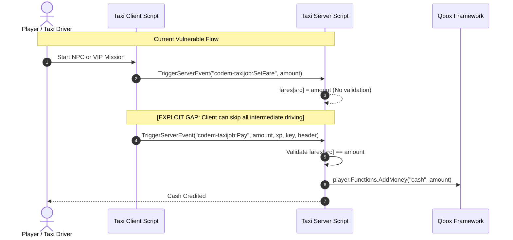
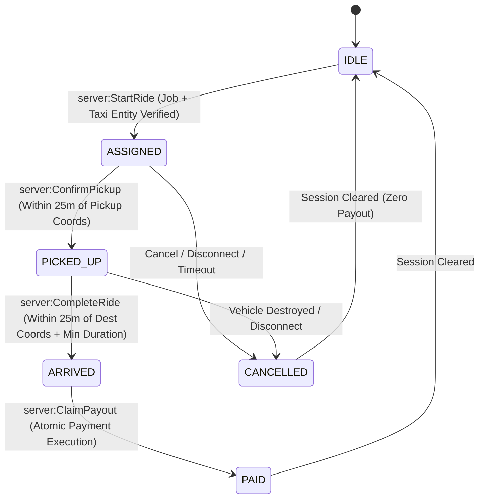

# CHICAGO ROLEPLAY — TAXI RIDE SESSION ARCHITECTURE & SECURITY AUDIT

**Document Identifier:** `CHICAGO-AUDIT-TAXI-SESSION-01`  
**Target Resource:** `codem-taxijob2`  
**Framework Environment:** Qbox (`qbx_core`, `qbx_vehiclekeys`, `ox_inventory`, `oxmysql`)  
**Audit Mode:** STRICT READ-ONLY. No code, configuration, or database modifications executed.

---

## 1. EXECUTIVE SUMMARY

An exhaustive code audit of `codem-taxijob2` was conducted across all client, server, and configuration files to determine whether the existing architecture can securely prove that a taxi ride actually occurred before paying out cash and awarding experience points.

### Key Audit Conclusions:
1. **Critical Financial Exploit Confirmed:** The current production implementation does not verify that a ride took place. Any connected player with network execution access can trigger `codem-taxijob:SetFare` followed immediately by `codem-taxijob:Pay` to generate arbitrary cash ($1 to $5,000+) and XP in fractions of a second without owning a taxi, moving, or picking up passengers.
2. **Leftover Debug Command Discovered:** An active debug command (`/triggerpay <amount>`) is present at line 722 of `client/main.lua`, directly triggering payment events.
3. **Double Registration Detected:** Both `server/editable.lua` (line 1) and `server/main.lua` (line 605) register identical network event handlers for `codem-taxijob:Pay`. When invoked, both handlers execute concurrently on the server.
4. **Feasibility of Server-Side Proof:** A server-authoritative ride state machine **can** be implemented within `codem-taxijob2` without replacing the resource, requiring targeted edits to exactly two files (`client/main.lua` and `server/main.lua`), while eliminating the redundant `server/editable.lua`.

---

## 2. CALL TREE & EVENT FLOW (EXACT LINE REFERENCES)

### A. Callers of `codem-taxijob:SetFare`
- **Client Call 1:** [`client/editable.lua:36`](file:///C:/Users/Administrator/Desktop/CHICAGO%20SERVER/txData/Qbox_C6CA87.base/resources/[customs]/[jobs]/codem-taxijob2/client/editable.lua#L36)  
  *(Dead code: `client/editable.lua` is excluded from `client_scripts` in `fxmanifest.lua`)*
- **Client Call 2:** [`client/main.lua:602`](file:///C:/Users/Administrator/Desktop/CHICAGO%20SERVER/txData/Qbox_C6CA87.base/resources/[customs]/[jobs]/codem-taxijob2/client/main.lua#L602)  
  Called in `CreateCustomer()` when an NPC customer is assigned. Sets client-generated randomized fare:
  ```lua
  local payment = math.random(missionConfig.minPayment, missionConfig.maxPayment)
  TriggerServerEvent('codem-taxijob:SetFare', payment)
  ```
- **Client Call 3:** [`client/main.lua:762`](file:///C:/Users/Administrator/Desktop/CHICAGO%20SERVER/txData/Qbox_C6CA87.base/resources/[customs]/[jobs]/codem-taxijob2/client/main.lua#L762)  
  Called in `startVip` NUI callback when driver clicks "Start" on a VIP mission from the tablet:
  ```lua
  TriggerServerEvent("codem-taxijob:SetFare", selectedMission.payment)
  ```
- **Server Handler:** [`server/main.lua:158-162`](file:///C:/Users/Administrator/Desktop/CHICAGO%20SERVER/txData/Qbox_C6CA87.base/resources/[customs]/[jobs]/codem-taxijob2/server/main.lua#L158-L162)  
  ```lua
  RegisterServerEvent("codem-taxijob:SetFare")
  AddEventHandler("codem-taxijob:SetFare", function(fareAmount)
    local playerId = source
    fares[playerId] = fareAmount
  end)
  ```
  *Analysis:* Takes raw unvalidated number from client, stores directly in `fares[playerId]`. Zero verification of driver job, location, vehicle, or session existence.

### B. Callers of `codem-taxijob:Pay`
- **Client Call 1:** [`client/main.lua:699`](file:///C:/Users/Administrator/Desktop/CHICAGO%20SERVER/txData/Qbox_C6CA87.base/resources/[customs]/[jobs]/codem-taxijob2/client/main.lua#L699)  
  Called when regular NPC reaches destination:
  ```lua
  TriggerServerEvent('codem-taxijob:Pay', taximeter.fare, math.random(missionConfig.minXP, missionConfig.maxXP), key, missionConfig.header)
  ```
- **Client Call 2 (Vulnerability):** [`client/main.lua:722`](file:///C:/Users/Administrator/Desktop/CHICAGO%20SERVER/txData/Qbox_C6CA87.base/resources/[customs]/[jobs]/codem-taxijob2/client/main.lua#L722)  
  Active debug command left in code:
  ```lua
  RegisterCommand("triggerpay", function(source, args)
    TriggerServerEvent("codem-taxijob:Pay", tonumber(args[1]), math.random(50, 100), key, "test")
  end)
  ```
- **Client Call 3:** [`client/main.lua:911`](file:///C:/Users/Administrator/Desktop/CHICAGO%20SERVER/txData/Qbox_C6CA87.base/resources/[customs]/[jobs]/codem-taxijob2/client/main.lua#L911)  
  Called when VIP customer reaches destination:
  ```lua
  TriggerServerEvent("codem-taxijob:Pay", taximeter.fare, math.random(selectedMission.minxp, selectedMission.maxxp), key, selectedMission.name)
  ```
- **Server Handlers:**
  - [`server/editable.lua:1-26`](file:///C:/Users/Administrator/Desktop/CHICAGO%20SERVER/txData/Qbox_C6CA87.base/resources/[customs]/[jobs]/codem-taxijob2/server/editable.lua#L1-L26)
  - [`server/main.lua:605-645`](file:///C:/Users/Administrator/Desktop/CHICAGO%20SERVER/txData/Qbox_C6CA87.base/resources/[customs]/[jobs]/codem-taxijob2/server/main.lua#L605-L645)  
  *Analysis:* Both files contain near-identical logic. They only check `if clientkey ~= key` and `if fares[src] ~= amount`. If match, they call `fares[src] = nil` and `AddMoney(src, amount)`.

---

## 3. RIDE LIFECYCLE FORENSIC BREAKDOWN



### Stage-by-Stage Verification:

1. **Ride Start:**
   - **Regular NPC:** Triggered when driver toggles meter or NPC job (`DoTaxiNpc`). Client waits 10–15 seconds, randomly picks NPC spawn coordinates, calculates `payment`, and calls `SetFare`.
   - **VIP Mission:** Triggered via NUI callback `startVip`. Client reads mission payment from config and calls `SetFare`.
   - *Server State:* None. Server only knows a number was submitted to `fares[playerId]`.
2. **Passenger / NPC Selection:**
   - Handled 100% locally on the client via `SpawnPed()` (`client/main.lua:608` and `client/main.lua:790`). The ped entity is client-side only (not networked, zero server visibility).
3. **Pickup Confirmation:**
   - Handled 100% locally on the client via distance check (`#(playerCoords - selectedCoords) < 5.0`). When within range, client scripts `TaskEnterVehicle()`. Zero server notification or validation occurs.
4. **Destination Selection:**
   - Handled 100% locally on the client. Selected randomly from `missionConfig.finishLocations` table. Server is unaware of the destination.
5. **Arrival & Completion Confirmation:**
   - Handled 100% locally on the client via `#(playerCoords - selectedFinishCoords) < 5.0`. Client commands ped to exit, triggers `codem-taxijob:Pay`.
6. **Fare Calculation:**
   - Calculated entirely on the client. Subject to client-side deductions for reckless driving (`cutpercent`) or slow driving (`taximeter.fare / 2`).

### Vulnerability Verdict:
**Confirmed.** The server maintains zero state machine. A malicious client does not need to spawn a vehicle, drive to pickup, pick up a ped, or drive to a destination. Sending `SetFare(X)` followed by `Pay(X)` instantly satisfies the server's only check (`fares[playerId] == amount`).

---

## 4. INSTALLED QBOX INTEGRATION FORENSIC AUDIT

Inspection of `qbx_core` on this server revealed crucial details about how money and players are handled:

### A. `GetPlayer(source)`
- Implemented in `codem-taxijob2/server/main.lua:468`:
  ```lua
  function GetPlayer(playerId)
    return Core.Functions.GetPlayer(playerId)
  end
  ```
- In Qbox, `Core.Functions.GetPlayer(playerId)` returns the player data table with `player.PlayerData.job.name`.
- *Security Requirement:* Must always guard with `player?.PlayerData?.job?.name == 'taxi'` to prevent runtime crashes if a player disconnects mid-event.

### B. `AddMoney(playerId, amount)` Behavior
- Implemented in `codem-taxijob2/server/main.lua:374`:
  ```lua
  function AddMoney(playerId, amount)
    player.Functions.AddMoney("cash", amount)
  end
  ```
- Forensic inspection of `qbx_core/server/player.lua:850` and `qbx_core/server/player.lua:1321` revealed:
  ```lua
  function AddMoney(identifier, moneyType, amount, reason)
      local player = resolvePlayer(identifier)
      if not player then return false end
      local validAmount = validateMoneyAmount(amount)
      if not validAmount or not player.PlayerData.money[moneyType] then return false end
      ...
      return true
  end
  ```
  **`AddMoney` in `qbx_core` returns a boolean (`true` or `false`) synchronously!**
- *Flaw in existing code:* `codem-taxijob2` discards this return value and does not check whether cash was actually added. Wrapping it in `pcall()` merely tests if the function call itself crashed, not whether the transaction succeeded.
- *Fix:* Check `if player.Functions.AddMoney("cash", amount, "taxi-fare") == true then ... end`.

---

## 5. SERVER-AUTHORITATIVE RIDE STATE MACHINE DESIGN

To convert Taxi from an unverified "Fare Storage" into a secure "Ride Session State", the server must own and enforce the ride lifecycle:



### Architectural Components:

```lua
-- Proposed Server Session Record:
activeTaxiSessions[driverSource] = {
    rideId = "TAXI_" .. driverSource .. "_" .. os.time(),
    driver = driverSource,
    vehicleNetId = vehNet,
    missionType = "npc" or "vip",
    missionId = missionId,
    state = "ASSIGNED", -- ASSIGNED -> PICKED_UP -> ARRIVED -> PAID
    pickupCoords = vector3(x, y, z),
    destCoords = vector3(x, y, z),
    startTime = os.time(),
    pickupTime = nil,
    completionTime = nil,
    authorizedFare = calculatedFare,
    authorizedXP = calculatedXP,
}
```

### State Validation Rules:

1. **State 1: `StartRide(missionType, missionId, pickupCoords, destCoords, vehNet)`**
   - Driver must have Qbox job `taxi`.
   - Driver must not have an active session in progress.
   - Driver must be inside the registered taxi vehicle (`vehNet`).
   - For VIP missions: server reads exact `payment` and `destCoords` directly from `Config.VipMissions[missionId]`.
   - For NPC missions: server validates that `pickupCoords` and `destCoords` match genuine coordinates from `Config.NPCMission`.
   - Server calculates the authorized fare ceiling and XP directly from server configuration.
2. **State 2: `ConfirmPickup(rideId)`**
   - Session must exist and be in state `ASSIGNED`.
   - Server checks driver ped coordinates: `#(driverCoords - session.pickupCoords) <= 25.0`.
   - Server updates `state = 'PICKED_UP'` and records `session.pickupTime = os.time()`.
3. **State 3: `CompleteRide(rideId)`**
   - Session must exist and be in state `PICKED_UP`.
   - Server checks driver ped coordinates: `#(driverCoords - session.destCoords) <= 25.0`.
   - **Realistic Minimum Duration Check:**
     `local straightDistance = #(session.pickupCoords - session.destCoords)`  
     `local minSeconds = math.max(15, math.floor(straightDistance / 35.0))` (assuming max realistic average speed of ~125 km/h across terrain).
     If `os.time() - session.pickupTime < minSeconds`, request is flagged as speed/teleport hack.
   - Server updates `state = 'ARRIVED'`.
4. **State 4: `ClaimPayout(rideId)`**
   - Session must exist and be in state `ARRIVED`.
   - Atomic state lock: `session.state = 'PROCESSING'`.
   - Server pays `session.authorizedFare` via `player.Functions.AddMoney("cash", session.authorizedFare, "taxi-fare")`.
   - If `true`:
     - Awards `session.authorizedXP`.
     - Updates database stats.
     - Sets `session.state = 'PAID'`.
     - Deletes session `activeTaxiSessions[driverSource] = nil`.
   - If `false`:
     - Reverts `session.state = 'ARRIVED'` and logs critical warning (session preserved, zero duplicate spend).

---

## 6. MINIMAL REQUIRED FILES FOR IMPLEMENTATION

To execute this architecture with surgical precision and zero bloat:

| File | Proposed Action | Purpose |
| :--- | :--- | :--- |
| `[customs]/[jobs]/codem-taxijob2/server/main.lua` | **Modify** | Implement `activeTaxiSessions` state machine, validation endpoints, and secure `AddMoney` return checks. Remove leftover duplicate pay handler. |
| `[customs]/[jobs]/codem-taxijob2/server/editable.lua` | **Deprecate / Clear** | Empty the redundant duplicate `RegisterServerEvent('codem-taxijob:Pay')` to eliminate concurrent execution collisions. |
| `[customs]/[jobs]/codem-taxijob2/client/main.lua` | **Modify** | Delete leftover `/triggerpay` command (line 722). Connect client lifecycle milestones (spawn, customer board, arrival) to the server state callbacks. |
| `[customs]/[jobs]/codem-taxijob2/shared/config.lua` | **Modify** | Set `Config.JobCheck = { enable = true, name = 'taxi' }`. |

---

## 7. COMPREHENSIVE TEST CASES (VERIFICATION MATRIX)

| Test Case | Scenario / Attack Vector | Expected System Reaction | Result Criteria |
| :--- | :--- | :--- | :--- |
| **TC-01: Forged Fare** | Client calls `SetFare(999999)` or `Pay(999999)` without session. | Request rejected. No session exists; server does not read client fare. | **PASS** — Zero cash paid. |
| **TC-02: Instant Fake Ride** | Client calls `StartRide` and immediately calls `CompleteRide` (0s elapsed). | Rejected by `CompleteRide` minimum duration check (`minSeconds`). | **PASS** — Exploit blocked, logged in console. |
| **TC-03: Teleport Ride Completion** | Client calls `CompleteRide` while standing at Legion Square instead of destination. | Rejected by destination coordinate distance check (`> 25.0m`). | **PASS** — Exploit blocked. |
| **TC-04: Replay Attack** | Client records payload of legitimate `ClaimPayout` and resends it 10 times. | First call consumes session (`state = 'PAID'`). Subsequent 9 calls find no active session. | **PASS** — Exactly-once payment. |
| **TC-05: Concurrent Double Spend** | Client sends 5 simultaneous asynchronous `ClaimPayout` requests. | Atomic lock (`state = 'PROCESSING'`) ensures only the first thread executes `AddMoney`. | **PASS** — No duplicate payout. |
| **TC-06: Job Switch Mid-Ride** | Player starts taxi mission, uses menu/admin to switch job to `unemployed`, then triggers finish. | Rejected at completion/payout stage: `player.PlayerData.job.name ~= 'taxi'`. | **PASS** — Payment refused, session cancelled. |
| **TC-07: Player Disconnect** | Player drops from server while on an active ride (`playerDropped`). | Server cleans up `activeTaxiSessions[source] = nil`. No memory leak or ghost session. | **PASS** — Clean resource recovery. |
| **TC-08: Transaction Failure** | Qbox database or wallet failure returns `false` during `AddMoney`. | Session transitions back to `ARRIVED`, transaction logged as failed, no stat inflation. | **PASS** — Driver does not lose progress; admin can reconcile. |

---

## 8. OWNER ACTION REQUIRED

This audit report is complete. **No changes have been made to production files.**

Awaiting owner review and explicit authorization to proceed with implementing the Taxi Ride Session State Machine or adjusting project priorities.

