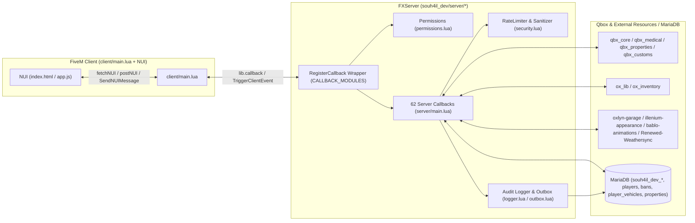

# CHICAGO ROLEPLAY — `SOUH4IL-DEV` MOD MENU
## COMPLETE TECHNICAL AUDIT, SECURITY REVIEW, EXTERNAL INTEGRATION & PRODUCTION READINESS REPORT

**Date:** 2026-11-07  
**Mode:** STRICT READ-ONLY AUDIT (Zero runtime mutations, zero code/config/SQL modifications)  
**Target Resource:** [`souh4il_dev`](file:///C:/Users/Administrator/Desktop/CHICAGO%20SERVER/txData/Qbox_C6CA87.base/resources/%5Bcustoms%5D/souh4il_dev/fxmanifest.lua) (`v2.0.0`)  
**Framework Stack:** FiveM (`cerulean` / `lua54`) + `qbx_core` + `ox_lib` + `ox_inventory` + `oxmysql`

---

## 1. Executive Summary

`souh4il_dev` (`SOUH4IL-DEV`) is a custom, 16-tab administrative, developer, and server-owner control panel built specifically for **CHICAGO ROLEPLAY** on Qbox (`qbx_core`). Unlike generic off-the-shelf menus, it features a canonical Owner identity lock, an append-only SQL audit logger (`souh4il_dev_audit_logs`), a transactional Discord webhook outbox (`souh4il_dev_outbox`), a live 16-tab/86-key granular permission studio (`souh4il_dev_staff`), a dynamic Smart Police NPC & global population controller, and deep integrations with `ox_inventory`, `qbx_properties`, `oxlyn-garage`, `illenium-appearance`, `bablo-animations`, and `Renewed-Weathersync`.

However, this read-only audit uncovered **critical security privilege-escalation paths, broken backend callbacks, dead NUI controls, blocking browser dialogs (`confirm`/`alert`) that fail in FiveM CEF, schema mismatches on database fallback inserts, and active conflicts with a second third-party admin menu (`snipe-menu`) and `qbx_density`**.

### Key Audit Highlights
- **What Works Well:**
  - Canonical Owner verification ([`server/permissions.lua`](file:///C:/Users/Administrator/Desktop/CHICAGO%20SERVER/txData/Qbox_C6CA87.base/resources/%5Bcustoms%5D/souh4il_dev/server/permissions.lua#L550-L578)) with multi-identifier enforcement (`license`, `discord`, `fivem`) and anti-spoofing warning alerts.
  - Append-only database audit logging ([`server/logger.lua`](file:///C:/Users/Administrator/Desktop/CHICAGO%20SERVER/txData/Qbox_C6CA87.base/resources/%5Bcustoms%5D/souh4il_dev/server/logger.lua#L62-L133)) and asynchronous outbox worker ([`server/outbox.lua`](file:///C:/Users/Administrator/Desktop/CHICAGO%20SERVER/txData/Qbox_C6CA87.base/resources/%5Bcustoms%5D/souh4il_dev/server/outbox.lua#L55-L129)) with exponential backoff and PII token redaction.
  - Auto-bootstrapped SQL tables on resource start ([`server/main.lua`](file:///C:/Users/Administrator/Desktop/CHICAGO%20SERVER/txData/Qbox_C6CA87.base/resources/%5Bcustoms%5D/souh4il_dev/server/main.lua#L194-L249)) so the resource never crashes on missing tables.
  - Dynamic catalog loaders for `ox_inventory` items, `qbx_core` vehicles/jobs/gangs, `illenium-appearance` peds, and `bablo-animations` emotes.
- **Critical Blockers (`P0` / `P1`):**
  1. **`setPlayerGang` is 100% Broken (`CONFIRMED BUG`):** [`souh4il_dev:server:setPlayerGang`](file:///C:/Users/Administrator/Desktop/CHICAGO%20SERVER/txData/Qbox_C6CA87.base/resources/%5Bcustoms%5D/souh4il_dev/server/main.lua#L1644) calls `Security.CheckRateLimit(source, 'set_gang')`, but `'set_gang'` is missing from [`Config.RateLimits`](file:///C:/Users/Administrator/Desktop/CHICAGO%20SERVER/txData/Qbox_C6CA87.base/resources/%5Bcustoms%5D/souh4il_dev/config/shared.lua#L13-L40). Because [`Security.CheckRateLimit`](file:///C:/Users/Administrator/Desktop/CHICAGO%20SERVER/txData/Qbox_C6CA87.base/resources/%5Bcustoms%5D/souh4il_dev/server/security.lua#L28-L31) is fail-closed, every attempt to set a player's gang is rejected with `UNCONFIGURED_ACTION_REJECTED`.
  2. **Legacy Third-Party Admin Menu (`snipe-menu`) Active Alongside `souh4il_dev` (`CONFIRMED SECURITY ISSUE` & `CONFIRMED CONFLICT`):** Because [`server.cfg`](file:///C:/Users/Administrator/Desktop/CHICAGO%20SERVER/txData/Qbox_C6CA87.base/server.cfg#L94) runs `ensure [customs]`, [`resources/[customs]/snipe-menu`](file:///C:/Users/Administrator/Desktop/CHICAGO%20SERVER/txData/Qbox_C6CA87.base/resources/%5Bcustoms%5D/snipe-menu/fxmanifest.lua) is loaded in production with hardcoded third-party `god` identifiers in [`snipe-menu/config/permissions.lua`](file:///C:/Users/Administrator/Desktop/CHICAGO%20SERVER/txData/Qbox_C6CA87.base/resources/%5Bcustoms%5D/snipe-menu/config/permissions.lua#L29-L36) (`license:6447ec2fb8001c2007faf7257edb0f6202cacb22`, `fivem:2859092`, `fivem:16441984`, `XY123456`) and hijacks `/noclip`, `/tpm`, and `/report`.
  3. **Missing Hierarchy Protection (`CanTargetPlayer`) on 20+ Target Actions (`CONFIRMED SECURITY ISSUE`):** [`Permissions.CanTargetPlayer(source, targetId)`](file:///C:/Users/Administrator/Desktop/CHICAGO%20SERVER/txData/Qbox_C6CA87.base/resources/%5Bcustoms%5D/souh4il_dev/server/permissions.lua#L778-L804) is only checked in `banPlayer` and `kickPlayer`. A Moderator or Admin can target the canonical Owner or higher-ranked staff with `forceLogout` (which executes `DropPlayer`—an unguarded kick!), `controlPlayerVitals` (`kill`), `freezePlayer`, `wipePlayer`, `clearPlayerInventory`, `trollPlayer`, `seizePlayerVehicle`, and `seizePlayerProperty`.
  4. **Granular Sub-Permission Escalation in `CALLBACK_MODULES` & `HasModulePermission` (`CONFIRMED SECURITY ISSUE`):**
     - Staff with `player_heal` (Moderators) can invoke `controlPlayerVitals` with `vitalsType = 'kill'` or `'godmode'` ([`server/main.lua`](file:///C:/Users/Administrator/Desktop/CHICAGO%20SERVER/txData/Qbox_C6CA87.base/resources/%5Bcustoms%5D/souh4il_dev/server/main.lua#L28)).
     - Staff with `spawn_vehicles` (Moderators/Developers) can invoke [`saveMyCurrentVehicle`](file:///C:/Users/Administrator/Desktop/CHICAGO%20SERVER/txData/Qbox_C6CA87.base/resources/%5Bcustoms%5D/souh4il_dev/server/main.lua#L60) to permanently write spawned vehicles into `player_vehicles` despite `veh_save_garage = false`.
     - Staff with `dash_self_cash` (+50k self button) are granted full `manage_money` on the server ([`server/permissions.lua`](file:///C:/Users/Administrator/Desktop/CHICAGO%20SERVER/txData/Qbox_C6CA87.base/resources/%5Bcustoms%5D/souh4il_dev/server/permissions.lua#L682-L683)), allowing unlimited money creation/removal on any player via `managePlayerMoney`.
  5. **Missing Client Handlers & Broken UI Actions (`CONFIRMED BUG`):**
     - `ban_offline`, `unban`, and `create_stash` are dispatched by [`web/js/app.js`](file:///C:/Users/Administrator/Desktop/CHICAGO%20SERVER/txData/Qbox_C6CA87.base/resources/%5Bcustoms%5D/souh4il_dev/web/js/app.js#L827) via `postNUI('playerDetailedAction', ...)`, but [`client/main.lua`](file:///C:/Users/Administrator/Desktop/CHICAGO%20SERVER/txData/Qbox_C6CA87.base/resources/%5Bcustoms%5D/souh4il_dev/client/main.lua#L2085-L2390) has **no `elseif` branches** for `ban_offline`, `unban`, or `create_stash`.
     - Duplicate HTML IDs (`#btn-clear-veh`, `#btn-clear-peds`, `#btn-clear-props`, `#custom-skin-input`) in [`web/index.html`](file:///C:/Users/Administrator/Desktop/CHICAGO%20SERVER/txData/Qbox_C6CA87.base/resources/%5Bcustoms%5D/souh4il_dev/web/index.html#L406-L408) and [`#pane-devtools`](file:///C:/Users/Administrator/Desktop/CHICAGO%20SERVER/txData/Qbox_C6CA87.base/resources/%5Bcustoms%5D/souh4il_dev/web/index.html#L1292-L1316) leave the DevTools buttons dead.
     - Native browser `confirm()` and `alert()` calls in [`web/js/app.js`](file:///C:/Users/Administrator/Desktop/CHICAGO%20SERVER/txData/Qbox_C6CA87.base/resources/%5Bcustoms%5D/souh4il_dev/web/js/app.js#L2643-L2661) (`wipe`, `clear_inv`, `launchPresetEvent`, `stopActiveEvent`) fail or block in FiveM's Chromium Embedded Framework (CEF).

---

## 2. Architecture & File Inventory

### 2.1 Complete File Structure of `souh4il_dev`
Located at `c:\Users\Administrator\Desktop\CHICAGO SERVER\txData\Qbox_C6CA87.base\resources\[customs]\souh4il_dev\`:

| File Path | Lines | Role & Responsibility |
|---|---:|---|
| [`fxmanifest.lua`](file:///C:/Users/Administrator/Desktop/CHICAGO%20SERVER/txData/Qbox_C6CA87.base/resources/%5Bcustoms%5D/souh4il_dev/fxmanifest.lua#L1-L46) | 46 | Resource manifest, dependencies (`ox_lib`, `oxmysql`, `qbx_core`), shared/server/client/web definitions |
| [`config/shared.lua`](file:///C:/Users/Administrator/Desktop/CHICAGO%20SERVER/txData/Qbox_C6CA87.base/resources/%5Bcustoms%5D/souh4il_dev/config/shared.lua#L1-L44) | 44 | Panel metadata, keybind (`F10`), command (`/sdev`), `Config.RateLimits`, `Config.Validation` |
| [`config/permissions.lua`](file:///C:/Users/Administrator/Desktop/CHICAGO%20SERVER/txData/Qbox_C6CA87.base/resources/%5Bcustoms%5D/souh4il_dev/config/permissions.lua#L1-L27) | 27 | `PermissionsConfig` (require match count, ACE fallback flags, hardcoded owner identifiers) |
| [`config/permissions_souh4il.cfg`](file:///C:/Users/Administrator/Desktop/CHICAGO%20SERVER/txData/Qbox_C6CA87.base/resources/%5Bcustoms%5D/souh4il_dev/config/permissions_souh4il.cfg#L1-L29) | 29 | Reference ACE configuration template (mirrored in root [`permissions.cfg`](file:///C:/Users/Administrator/Desktop/CHICAGO%20SERVER/txData/Qbox_C6CA87.base/permissions.cfg#L1-L33)) |
| [`config/secrets.lua`](file:///C:/Users/Administrator/Desktop/CHICAGO%20SERVER/txData/Qbox_C6CA87.base/resources/%5Bcustoms%5D/souh4il_dev/config/secrets.lua#L1-L22) | 22 | Convar reader for owner identifiers (`sv_souh4il_owner_*`) and Discord webhook URLs |
| [`sql/schema.sql`](file:///C:/Users/Administrator/Desktop/CHICAGO%20SERVER/txData/Qbox_C6CA87.base/resources/%5Bcustoms%5D/souh4il_dev/sql/schema.sql#L1-L41) | 41 | Schema for `souh4il_dev_audit_logs` and `souh4il_dev_outbox` (note: `souh4il_dev_staff` is created in Lua) |
| [`server/identifiers.lua`](file:///C:/Users/Administrator/Desktop/CHICAGO%20SERVER/txData/Qbox_C6CA87.base/resources/%5Bcustoms%5D/souh4il_dev/server/identifiers.lua#L1-L125) | 125 | Identifier extraction, normalization (`license2` -> `license`), and PII masking (`MaskTable`) |
| [`server/security.lua`](file:///C:/Users/Administrator/Desktop/CHICAGO%20SERVER/txData/Qbox_C6CA87.base/resources/%5Bcustoms%5D/souh4il_dev/server/security.lua#L1-L107) | 107 | Fail-closed sliding-window rate limiter (`CheckRateLimit`) & input sanitizers |
| [`server/permissions.lua`](file:///C:/Users/Administrator/Desktop/CHICAGO%20SERVER/txData/Qbox_C6CA87.base/resources/%5Bcustoms%5D/souh4il_dev/server/permissions.lua#L1-L884) | 884 | Multi-tier RBAC (`owner` > `developer` > `admin` > `moderator` > `custom`), 16-tab/86-key presets, DB cache |
| [`server/logger.lua`](file:///C:/Users/Administrator/Desktop/CHICAGO%20SERVER/txData/Qbox_C6CA87.base/resources/%5Bcustoms%5D/souh4il_dev/server/logger.lua#L1-L146) | 146 | Append-only audit log writer (`souh4il_dev_audit_logs`) & outbox enqueueing |
| [`server/outbox.lua`](file:///C:/Users/Administrator/Desktop/CHICAGO%20SERVER/txData/Qbox_C6CA87.base/resources/%5Bcustoms%5D/souh4il_dev/server/outbox.lua#L1-L132) | 132 | Background worker polling `souh4il_dev_outbox` every 10s to dispatch Discord embeds |
| [`server/test_harness.lua`](file:///C:/Users/Administrator/Desktop/CHICAGO%20SERVER/txData/Qbox_C6CA87.base/resources/%5Bcustoms%5D/souh4il_dev/server/test_harness.lua#L1-L115) | 115 | Console-only (`source == 0`) self-test command `sdev_run_tests` |
| [`server/main.lua`](file:///C:/Users/Administrator/Desktop/CHICAGO%20SERVER/txData/Qbox_C6CA87.base/resources/%5Bcustoms%5D/souh4il_dev/server/main.lua#L1-L3291) | 3,291 | Core backend: `RegisterCallback` wrapper, 62 `lib.callback` endpoints, console commands, NPC controller |
| [`client/main.lua`](file:///C:/Users/Administrator/Desktop/CHICAGO%20SERVER/txData/Qbox_C6CA87.base/resources/%5Bcustoms%5D/souh4il_dev/client/main.lua#L1-L2946) | 2,946 | Client runtime: NUI bridge (61 `RegisterNUICallback`), God powers, NoClip, ESP, Spectate, Events, Emotes |
| [`web/index.html`](file:///C:/Users/Administrator/Desktop/CHICAGO%20SERVER/txData/Qbox_C6CA87.base/resources/%5Bcustoms%5D/souh4il_dev/web/index.html#L1-L2094) | 2,094 | 16-tab NUI structure and modals (Kick, Ban, Staff Studio, Ped/Vehicle Pickers, Asset Confirm) |
| [`web/js/app.js`](file:///C:/Users/Administrator/Desktop/CHICAGO%20SERVER/txData/Qbox_C6CA87.base/resources/%5Bcustoms%5D/souh4il_dev/web/js/app.js#L1-L5069) | 5,069 | Frontend state, catalogs, RBAC visibility engine (`applyStaffPermissionsUI`), NUI fetch/post |
| [`web/css/style.css`](file:///C:/Users/Administrator/Desktop/CHICAGO%20SERVER/txData/Qbox_C6CA87.base/resources/%5Bcustoms%5D/souh4il_dev/web/css/style.css#L1-L4388) | 4,388 | Cyberpunk dark theme (`1580x920` max `96vw x 94vh`), grids, cards, scrollbars, animations |

### 2.2 Architecture Flow

---

## 3. Complete Feature Inventory

Every feature across all 16 tabs and backend handlers has been audited against its actual implementation:

| Module / Tab | Feature | Exists | Implemented | Functional Evidence | Permission (UI / Server) | Server-Side Protected | Status |
|---|---|---|---|---|---|---|---|
| **Core / Auth** | Open Panel (`F10` / `/sdev`) | YES | YES | [`client/main.lua:260-322`](file:///C:/Users/Administrator/Desktop/CHICAGO%20SERVER/txData/Qbox_C6CA87.base/resources/%5Bcustoms%5D/souh4il_dev/client/main.lua#L260-L322), [`server/main.lua:254-292`](file:///C:/Users/Administrator/Desktop/CHICAGO%20SERVER/txData/Qbox_C6CA87.base/resources/%5Bcustoms%5D/souh4il_dev/server/main.lua#L254-L292) | `HasStaffAccess` | YES | **WORKING** |
| **1. Dashboard** | Live Player Counter & Duty Strip (Police/EMS/Mech/NPC Cops) | YES | YES | [`server/main.lua:349-396`](file:///C:/Users/Administrator/Desktop/CHICAGO%20SERVER/txData/Qbox_C6CA87.base/resources/%5Bcustoms%5D/souh4il_dev/server/main.lua#L349-L396) (`getServerMetrics`) | `dash_metrics` / `HasStaffAccess` | YES | **WORKING** |
| **1. Dashboard** | System Status / Security Posture / Audit Engine Cards | YES | NO (Static) | [`web/index.html:279-307`](file:///C:/Users/Administrator/Desktop/CHICAGO%20SERVER/txData/Qbox_C6CA87.base/resources/%5Bcustoms%5D/souh4il_dev/web/index.html#L279-L307) (Hardcoded HTML strings) | `tab_dashboard` | N/A | **STATIC UI** |
| **1. Dashboard** | Self Quick Actions (`Revive`, `Heal`, `Armor`, `Clean Ped`, `Fix Car`, `Flip`, `MaxMod`, `DV`, `TPM`) | YES | YES | [`server/main.lua:399-453`](file:///C:/Users/Administrator/Desktop/CHICAGO%20SERVER/txData/Qbox_C6CA87.base/resources/%5Bcustoms%5D/souh4il_dev/server/main.lua#L399-L453) (`requestQuickAction`) | `self_actions` / `self_actions` | YES | **WORKING** |
| **1. Dashboard** | Self Quick Cash (`+$50,000 Cash`) | YES | YES | [`web/index.html:356`](file:///C:/Users/Administrator/Desktop/CHICAGO%20SERVER/txData/Qbox_C6CA87.base/resources/%5Bcustoms%5D/souh4il_dev/web/index.html#L356) -> `giveMoney` | `dash_self_cash` / `manage_money` | YES (Escalation flaw) | **SECURITY ISSUE** |
| **1. Dashboard** | Global Mass Actions (`heal_all`, `revive_all`, `clean_world_cars`, `repair_all_cars`, `bonus_all`) | YES | YES | [`server/main.lua:1974-2015`](file:///C:/Users/Administrator/Desktop/CHICAGO%20SERVER/txData/Qbox_C6CA87.base/resources/%5Bcustoms%5D/souh4il_dev/server/main.lua#L1974-L2015) (`massServerAction`) | `mass_actions` / `world_control` | YES (No rate limit) | **WORKING (Needs RateLimit)** |
| **1. Dashboard** | Global Announcement Banner | YES | YES | [`server/main.lua:1125-1149`](file:///C:/Users/Administrator/Desktop/CHICAGO%20SERVER/txData/Qbox_C6CA87.base/resources/%5Bcustoms%5D/souh4il_dev/server/main.lua#L1125-L1149) (`sendAnnouncement`) | `dash_announce` / `world_announce` | YES | **WORKING** |
| **2. God Powers** | 12 Core Toggles (`GodMode`, `NoClip`, `Invisibility`, `SuperJump`, `FastRun`, `FastSwim`, `InfStamina`, `NoRagdoll`, `Thermal`, `NightVision`, `ExplosiveAmmo`, `ESP`) | YES | YES | [`client/main.lua:531-583`](file:///C:/Users/Administrator/Desktop/CHICAGO%20SERVER/txData/Qbox_C6CA87.base/resources/%5Bcustoms%5D/souh4il_dev/client/main.lua#L531-L583) | `god_powers` / 30s server loop | PARTIAL (Client-first) | **SECURITY ISSUE** |
| **2. God Powers** | 12 Extended Combat/Veh Toggles (`InfAmmo`, `NoRecoil`, `OneShot`, `ExplosivePunch`, `FireAmmo`, `SuperHandbrake`, `InstaStop`, `VehicleGodmode`, `RainbowCar`, `BoostHorn`, `VehicleJump`, `DriveOnWater`) | YES | YES | [`client/main.lua:585-755`](file:///C:/Users/Administrator/Desktop/CHICAGO%20SERVER/txData/Qbox_C6CA87.base/resources/%5Bcustoms%5D/souh4il_dev/client/main.lua#L585-L755) | `combat_powers`, `veh_powers` / 30s loop | PARTIAL (Client-first) | **SECURITY ISSUE** |
| **2. God Powers** | Self Utilities (`Clear Wanted`, `Refill Needs`, `Clear Blood`, `Suicide`, `Open My Inv`, `Bennys`, `Refuel`, `Engine Toggle`) | YES | YES | [`client/main.lua:757-800`](file:///C:/Users/Administrator/Desktop/CHICAGO%20SERVER/txData/Qbox_C6CA87.base/resources/%5Bcustoms%5D/souh4il_dev/client/main.lua#L757-L800), [`server/main.lua:1895-1912`](file:///C:/Users/Administrator/Desktop/CHICAGO%20SERVER/txData/Qbox_C6CA87.base/resources/%5Bcustoms%5D/souh4il_dev/server/main.lua#L1895-L1912) | `god_self_utils` | PARTIAL | **WORKING** |
| **2. God Powers** | Area Cleanup (`Clear Vehicles/Peds/Props 50m`) | YES | YES | [`client/main.lua:827-868`](file:///C:/Users/Administrator/Desktop/CHICAGO%20SERVER/txData/Qbox_C6CA87.base/resources/%5Bcustoms%5D/souh4il_dev/client/main.lua#L827-L868) | `god_area_clean` (UI only) | NO (Client-only) | **WORKING (Client-only)** |
| **3. Players** | Live Online Players Table, Search, Role Filter, Quick Actions | YES | PARTIAL | [`server/main.lua:297-346`](file:///C:/Users/Administrator/Desktop/CHICAGO%20SERVER/txData/Qbox_C6CA87.base/resources/%5Bcustoms%5D/souh4il_dev/server/main.lua#L297-L346), [`web/js/app.js:1748-1755`](file:///C:/Users/Administrator/Desktop/CHICAGO%20SERVER/txData/Qbox_C6CA87.base/resources/%5Bcustoms%5D/souh4il_dev/web/js/app.js#L1748-L1755) | `view_players` | YES | **UI BUG ON FILTER** |
| **4. Manage Player** | Player Dossier (Identifiers, CID, Job, Gang, Cash, Bank, Ping, Coords) | YES | YES | [`server/main.lua:1380-1452`](file:///C:/Users/Administrator/Desktop/CHICAGO%20SERVER/txData/Qbox_C6CA87.base/resources/%5Bcustoms%5D/souh4il_dev/server/main.lua#L1380-L1452) (`getPlayerDetails`) | `tab_manage` / `view_players` | YES | **WORKING** |
| **4. Manage Player** | Teleport (`GoTo`, `Bring`, `Bring Back`, `Send to Pillbox/Airport/Legion/Jail`) | YES | YES | [`server/main.lua:532-580`](file:///C:/Users/Administrator/Desktop/CHICAGO%20SERVER/txData/Qbox_C6CA87.base/resources/%5Bcustoms%5D/souh4il_dev/server/main.lua#L532-L580) (`teleportAction`) | `manage_tp` / `player_teleport` | YES (Missing `CanTargetPlayer`) | **SECURITY ISSUE** |
| **4. Manage Player** | Teleport Player A to Player B (`tp_to_player`) | YES | YES | [`server/main.lua:2198-2218`](file:///C:/Users/Administrator/Desktop/CHICAGO%20SERVER/txData/Qbox_C6CA87.base/resources/%5Bcustoms%5D/souh4il_dev/server/main.lua#L2198-L2218) (`teleportPlayerToPlayer`) | `manage_tp` | YES (Missing `CanTargetPlayer`) | **WORKING** |
| **4. Manage Player** | Freeze / Spectate Player | YES | YES | [`server/main.lua:583-601, 1007-1025`](file:///C:/Users/Administrator/Desktop/CHICAGO%20SERVER/txData/Qbox_C6CA87.base/resources/%5Bcustoms%5D/souh4il_dev/server/main.lua#L583-L601) | `manage_freeze`, `player_spectate` | YES (Missing `CanTargetPlayer`) | **WORKING** |
| **4. Manage Player** | Economy (`Give` / `Remove` / `Set` Cash & Bank) | YES | YES | [`server/main.lua:1611-1640`](file:///C:/Users/Administrator/Desktop/CHICAGO%20SERVER/txData/Qbox_C6CA87.base/resources/%5Bcustoms%5D/souh4il_dev/server/main.lua#L1611-L1640) (`managePlayerMoney`) | `manage_money` | YES (No amount cap, no hierarchy check) | **SECURITY ISSUE** |
| **4. Manage Player** | Live Pocket Inventory Grid (`+1`, `Retirer`, `Give Item`, `Open Inv`, `Clear Inv`) | YES | PARTIAL | [`server/main.lua:949-969, 1028-1062, 2132-2167, 2241-2263`](file:///C:/Users/Administrator/Desktop/CHICAGO%20SERVER/txData/Qbox_C6CA87.base/resources/%5Bcustoms%5D/souh4il_dev/server/main.lua#L2132-L2167) | `manage_inv`, `manage_give_item` | YES (`clear_inv` blocked by CEF `confirm()`) | **UI BUG (`clear_inv`)** |
| **4. Manage Player** | Set Target Job + Grade (`set_job_full`) | YES | YES | [`server/main.lua:2170-2195`](file:///C:/Users/Administrator/Desktop/CHICAGO%20SERVER/txData/Qbox_C6CA87.base/resources/%5Bcustoms%5D/souh4il_dev/server/main.lua#L2170-L2195) (`setPlayerJobDirect`) | `manage_jobs` | YES (Missing `CanTargetPlayer`) | **WORKING** |
| **4. Manage Player** | Set Target Gang + Grade (`set_gang`) | YES | BROKEN | [`server/main.lua:1643-1655`](file:///C:/Users/Administrator/Desktop/CHICAGO%20SERVER/txData/Qbox_C6CA87.base/resources/%5Bcustoms%5D/souh4il_dev/server/main.lua#L1643-L1655) (`setPlayerGang`) | `manage_jobs` | FAILS (`set_gang` rate limit missing) | **BROKEN (`P0`)** |
| **4. Manage Player** | Vitals (`Revive`, `Heal`, `Feed`, `Armor 100/0`, `Relieve Stress`, `Kill`, `Godmode`, `Drunk`, `Cuff`) | YES | YES | [`server/main.lua:1716-1767`](file:///C:/Users/Administrator/Desktop/CHICAGO%20SERVER/txData/Qbox_C6CA87.base/resources/%5Bcustoms%5D/souh4il_dev/server/main.lua#L1716-L1767) (`controlPlayerVitals`) | `manage_heal` (allows `kill`!) | YES (Sub-perm & hierarchy bypass) | **SECURITY ISSUE** |
| **4. Manage Player** | Target Vehicle Control (`Repair`, `MaxMod`, `Clean`, `Flip`, `Refuel`, `Lock/Unlock`, `Freeze`, `BurstTires`, `Delete`, `Eject`, `Spawn For`, `Give Keys`) | YES | YES | [`server/main.lua:1770-1823, 2221-2238`](file:///C:/Users/Administrator/Desktop/CHICAGO%20SERVER/txData/Qbox_C6CA87.base/resources/%5Bcustoms%5D/souh4il_dev/server/main.lua#L1770-L1823) | `player_vehicles` | YES | **WORKING** |
| **4. Manage Player** | Patrimoine: Owned Vehicles (`Give Car`, `Trunk`, `Glovebox`, `Bring`, `Garage`, `Fix`, `Keys`, `Transfer`, `Seize`) | YES | YES | [`server/main.lua:2266-2473, 2671-2960`](file:///C:/Users/Administrator/Desktop/CHICAGO%20SERVER/txData/Qbox_C6CA87.base/resources/%5Bcustoms%5D/souh4il_dev/server/main.lua#L2266-L2473) | `manage_assets` | YES (Missing rate limits) | **WORKING** |
| **4. Manage Player** | Patrimoine: Owned Properties (`Give Property`, `Stash`, `TP`, `Give Key`, `Reset Keys`, `Transfer`, `Seize`) | YES | PARTIAL | [`server/main.lua:1939-1971, 2476-2669`](file:///C:/Users/Administrator/Desktop/CHICAGO%20SERVER/txData/Qbox_C6CA87.base/resources/%5Bcustoms%5D/souh4il_dev/server/main.lua#L1939-L1971) | `manage_properties` | YES (`givePlayerProperty` SQL insert bug) | **SQL BUG ON INSERT** |
| **4. Manage Player** | Appearance Studio (`Illenium Menu`, `Barber`, `Tattoo`, `Outfits`, `Reload Skin`, `Apply Ped`) | YES | YES | [`server/main.lua:1826-1892`](file:///C:/Users/Administrator/Desktop/CHICAGO%20SERVER/txData/Qbox_C6CA87.base/resources/%5Bcustoms%5D/souh4il_dev/server/main.lua#L1826-L1892), [`client/main.lua:1061-1180`](file:///C:/Users/Administrator/Desktop/CHICAGO%20SERVER/txData/Qbox_C6CA87.base/resources/%5Bcustoms%5D/souh4il_dev/client/main.lua#L1061-L1180) | `player_clothing`, `manage_skins` | YES | **WORKING** |
| **4. Manage Player** | Trolls (`Slap`, `Launch`, `Fire`, `Explode`, `Ragdoll`, `Flashbang`, `Clone`, `Clown`, `AttackDog`, `UFO`, `FakeCash`, `Blackout`, `SpinCar`, `Doors`, `JailBox`) | YES | YES | [`server/main.lua:1676-1713`](file:///C:/Users/Administrator/Desktop/CHICAGO%20SERVER/txData/Qbox_C6CA87.base/resources/%5Bcustoms%5D/souh4il_dev/server/main.lua#L1676-L1713), [`client/main.lua:1185-1450`](file:///C:/Users/Administrator/Desktop/CHICAGO%20SERVER/txData/Qbox_C6CA87.base/resources/%5Bcustoms%5D/souh4il_dev/client/main.lua#L1185-L1450) | `manage_trolls` | YES (Missing `CanTargetPlayer`) | **SECURITY ISSUE** |
| **4. Manage Player** | Sanctions (`Warn`, `PM`, `Kick`, `Ban`, `Force Relog`, `Wipe Cash/Inv/Full`) | YES | PARTIAL | [`server/main.lua:457-529, 1574-1608, 1915-1936, 2055-2089`](file:///C:/Users/Administrator/Desktop/CHICAGO%20SERVER/txData/Qbox_C6CA87.base/resources/%5Bcustoms%5D/souh4il_dev/server/main.lua#L457-L529) | `punish_kicks`, `punish_bans`, `manage_wipes` | YES (`wipe` blocked by CEF `confirm()`, `forceLogout` drops player) | **BUG (`wipe` / `forceLogout`)** |
| **5. Teleport** | Waypoint TP, 12 Presets, X/Y/Z Coords TP, Copy Coords, Bookmarks | YES | PARTIAL | [`client/main.lua:870-960`](file:///C:/Users/Administrator/Desktop/CHICAGO%20SERVER/txData/Qbox_C6CA87.base/resources/%5Bcustoms%5D/souh4il_dev/client/main.lua#L870-L960), [`web/js/app.js:3462-3478`](file:///C:/Users/Administrator/Desktop/CHICAGO%20SERVER/txData/Qbox_C6CA87.base/resources/%5Bcustoms%5D/souh4il_dev/web/js/app.js#L3462-L3478) | `world_teleport` | PARTIAL (Client TP local, Bookmark reads `#tp-x` inputs) | **UX/UI BUG ON BOOKMARK** |
| **6. Items & Weapons** | Visual `ox_inventory` Spawner (`+1`, `+5`, `+10`), Target Selector, Custom Item Spawn, Weapon Upgrade/Tint | YES | YES | [`server/main.lua:604-669`](file:///C:/Users/Administrator/Desktop/CHICAGO%20SERVER/txData/Qbox_C6CA87.base/resources/%5Bcustoms%5D/souh4il_dev/server/main.lua#L604-L669), [`client/main.lua:962-1015`](file:///C:/Users/Administrator/Desktop/CHICAGO%20SERVER/txData/Qbox_C6CA87.base/resources/%5Bcustoms%5D/souh4il_dev/client/main.lua#L962-L1015) | `spawn_items` (Sub-perms UI-only) | PARTIAL (Weapon upgrade client-only) | **SECURITY ISSUE** |
| **7. Vehicles** | Visual Vehicle Catalog, Manual Spawn, MaxMod, Custom Plate, Save to Personal Garage, Paint | YES | YES | [`server/main.lua:672-863, 2018-2052`](file:///C:/Users/Administrator/Desktop/CHICAGO%20SERVER/txData/Qbox_C6CA87.base/resources/%5Bcustoms%5D/souh4il_dev/server/main.lua#L672-L863) | `spawn_vehicles` (`veh_save_garage` UI-only!) | PARTIAL (`saveMyCurrentVehicle` allows Mods) | **SECURITY ISSUE** |
| **8. Characters** | Visual Ped Spawner (1,051+ Peds from `illenium-appearance`), Reset MP Male/Female | YES | YES | [`server/main.lua:1194-1231`](file:///C:/Users/Administrator/Desktop/CHICAGO%20SERVER/txData/Qbox_C6CA87.base/resources/%5Bcustoms%5D/souh4il_dev/server/main.lua#L1194-L1231), [`client/main.lua:341-376`](file:///C:/Users/Administrator/Desktop/CHICAGO%20SERVER/txData/Qbox_C6CA87.base/resources/%5Bcustoms%5D/souh4il_dev/client/main.lua#L341-L376) | `chars_catalog` (Client-side `setPedModel`) | NO (Local client native) | **NOTE: Ped Spawner, NOT DB Character Manager** |
| **9. Jobs & Ranks** | Visual Qbox Jobs & Gangs Catalog (`Set My Job` / `Set Target Job`) | YES | YES | [`server/main.lua:1299-1377`](file:///C:/Users/Administrator/Desktop/CHICAGO%20SERVER/txData/Qbox_C6CA87.base/resources/%5Bcustoms%5D/souh4il_dev/server/main.lua#L1299-L1377) | `jobs_catalog` / `manage_jobs` | YES | **WORKING (Gangs clicked in catalog call `setMyJob` if self!)** |
| **10. Owner Arsenal** | Tactical Kits (`swat`, `gang`, `medic`, `sniper`, `heist`, `starter`), Give Money (`cash`/`bank`/`crypto`) | YES | YES | [`server/main.lua:866-946`](file:///C:/Users/Administrator/Desktop/CHICAGO%20SERVER/txData/Qbox_C6CA87.base/resources/%5Bcustoms%5D/souh4il_dev/server/main.lua#L866-L946) | `arsenal`, `arsenal_economy` | YES | **WORKING** |
| **11. World & Weather** | Smart Police NPC Controller & Density Sliders, Weather, Time | YES | PARTIAL | [`server/main.lua:1066-1122, 1456-1561`](file:///C:/Users/Administrator/Desktop/CHICAGO%20SERVER/txData/Qbox_C6CA87.base/resources/%5Bcustoms%5D/souh4il_dev/server/main.lua#L1456-L1561) | `world_control`, `npc_control` | YES (Density conflicts with `qbx_density`) | **CONFLICT WITH `qbx_density`** |
| **11. World & Weather** | Global World Toggles (`Freeze Time`, `Freeze Weather`, `City Blackout`) | YES | BROKEN (Local only) | [`client/main.lua:801-824`](file:///C:/Users/Administrator/Desktop/CHICAGO%20SERVER/txData/Qbox_C6CA87.base/resources/%5Bcustoms%5D/souh4il_dev/client/main.lua#L801-L824) | `world_control` (UI only) | NO (Never sent to server/`GlobalState`) | **BROKEN (Client-local only)** |
| **11. World & Weather** | Custom Click Console Command Runner (`#custom-click-input`) | YES | BROKEN | [`web/js/app.js:818-821`](file:///C:/Users/Administrator/Desktop/CHICAGO%20SERVER/txData/Qbox_C6CA87.base/resources/%5Bcustoms%5D/souh4il_dev/web/js/app.js#L818-L821) | `world_props_cmd` | Calls `quickAction` -> `UNKNOWN_ACTION` | **BROKEN** |
| **11. World & Weather** | Custom Job & Gang Stash Builder (`#btn-create-custom-stash`) | YES | BROKEN | [`web/js/app.js:824-828`](file:///C:/Users/Administrator/Desktop/CHICAGO%20SERVER/txData/Qbox_C6CA87.base/resources/%5Bcustoms%5D/souh4il_dev/web/js/app.js#L824-L828) | `world_props_cmd` | Missing in `client/main.lua` & `server/main.lua` | **BROKEN (Unimplemented)** |
| **11. World & Weather** | Offline Ban & Unban (`#btn-offline-ban`, `#btn-unban-player`) | YES | BROKEN | [`web/js/app.js:2664-2685`](file:///C:/Users/Administrator/Desktop/CHICAGO%20SERVER/txData/Qbox_C6CA87.base/resources/%5Bcustoms%5D/souh4il_dev/web/js/app.js#L2664-L2685), [`server/main.lua:2092-2129`](file:///C:/Users/Administrator/Desktop/CHICAGO%20SERVER/txData/Qbox_C6CA87.base/resources/%5Bcustoms%5D/souh4il_dev/server/main.lua#L2092-L2129) | `world_offline_ban` / `punish_bans` | Missing NUI handler in `client/main.lua` | **BROKEN (Disconnected)** |
| **12. Dev Tools** | Entity Inspector, Coords HUD, Clear Area (50m), Custom Skin Hash | YES | PARTIAL | [`web/index.html:1272-1325`](file:///C:/Users/Administrator/Desktop/CHICAGO%20SERVER/txData/Qbox_C6CA87.base/resources/%5Bcustoms%5D/souh4il_dev/web/index.html#L1272-L1325) | `devtools` | Duplicate DOM IDs break Clear & Skin buttons | **BROKEN DOM IDs** |
| **13. Event Manager** | 5 Preset Events (`Fight`, `Race`, `Purge`, `Airdrop`, `Derby`) + Custom Event + Stop Event | YES | PARTIAL | [`server/main.lua:3112-3214`](file:///C:/Users/Administrator/Desktop/CHICAGO%20SERVER/txData/Qbox_C6CA87.base/resources/%5Bcustoms%5D/souh4il_dev/server/main.lua#L3112-L3214), [`web/js/app.js:4577-4637`](file:///C:/Users/Administrator/Desktop/CHICAGO%20SERVER/txData/Qbox_C6CA87.base/resources/%5Bcustoms%5D/souh4il_dev/web/js/app.js#L4577-L4637) | `events`, `events_custom` | Preset/Stop blocked by CEF `confirm()` | **UI BUG (`confirm()`)** |
| **14. Dances & Emotes** | 3,157+ Animations (`bablo-animations`), Play on Self / Target / Whole Server | YES | YES | [`server/main.lua:1234-1297, 3219-3264`](file:///C:/Users/Administrator/Desktop/CHICAGO%20SERVER/txData/Qbox_C6CA87.base/resources/%5Bcustoms%5D/souh4il_dev/server/main.lua#L3219-L3264) | `dances_emotes`, `emotes_target_*` | YES | **WORKING** |
| **15. Security Logs** | Append-Only Audit Log Viewer (`souh4il_dev_audit_logs`, last 100 rows) | YES | YES | [`server/main.lua:1152-1155`](file:///C:/Users/Administrator/Desktop/CHICAGO%20SERVER/txData/Qbox_C6CA87.base/resources/%5Bcustoms%5D/souh4il_dev/server/main.lua#L1152-L1155) (`getAuditLogs`) | `logs` | YES | **WORKING** |
| **16. Staff & Perms** | Live Staff Studio (16 Master Tabs + 86 Sub-Permissions, Add/Edit/Revoke) | YES | YES | [`server/main.lua:2966-3107`](file:///C:/Users/Administrator/Desktop/CHICAGO%20SERVER/txData/Qbox_C6CA87.base/resources/%5Bcustoms%5D/souh4il_dev/server/main.lua#L2966-L3107) | `staff_management` | YES | **WORKING** |
| **Missing Modules** | Reports/Tickets, DB Character Slot Manager, Real CPU/RAM Monitor, Backup Monitor, Society/Business Funds | NO | NO | Not present in `souh4il_dev` | N/A | N/A | **CONFIRMED MISSING** |

---

## 4. Admin / Owner Permission Audit & Cross-Check

### 4.1 Configuration vs. Runtime Permission Model
We cross-checked:
1. [`config/permissions.lua`](file:///C:/Users/Administrator/Desktop/CHICAGO%20SERVER/txData/Qbox_C6CA87.base/resources/%5Bcustoms%5D/souh4il_dev/config/permissions.lua#L1-L27)
2. [`config/permissions_souh4il.cfg`](file:///C:/Users/Administrator/Desktop/CHICAGO%20SERVER/txData/Qbox_C6CA87.base/resources/%5Bcustoms%5D/souh4il_dev/config/permissions_souh4il.cfg#L1-L29)
3. [`permissions.cfg`](file:///C:/Users/Administrator/Desktop/CHICAGO%20SERVER/txData/Qbox_C6CA87.base/permissions.cfg#L1-L33)
4. [`server/permissions.lua`](file:///C:/Users/Administrator/Desktop/CHICAGO%20SERVER/txData/Qbox_C6CA87.base/resources/%5Bcustoms%5D/souh4il_dev/server/permissions.lua#L1-L884)
5. [`server/main.lua`](file:///C:/Users/Administrator/Desktop/CHICAGO%20SERVER/txData/Qbox_C6CA87.base/resources/%5Bcustoms%5D/souh4il_dev/server/main.lua#L18-L163) (`CALLBACK_MODULES` & `RegisterCallback`)

#### Canonical Owner Resolution
- [`PermissionsConfig.HardcodedOwners`](file:///C:/Users/Administrator/Desktop/CHICAGO%20SERVER/txData/Qbox_C6CA87.base/resources/%5Bcustoms%5D/souh4il_dev/config/permissions.lua#L15-L19) defines:
  - `license:385f488fdcdc30a24c28b7a333ba9cbbffed5044`
  - `discord:792387618708914227`
  - `fivem:20069674`
- [`permissions.cfg`](file:///C:/Users/Administrator/Desktop/CHICAGO%20SERVER/txData/Qbox_C6CA87.base/permissions.cfg#L13-L25) sets `sv_souh4il_owner_license`, `sv_souh4il_owner_discord`, and `sv_souh4il_owner_fivem` to those same three identifiers and binds them to `group.admin`, `group.souh4il_owner`, and `souh4il_dev.owner`.
- **Important nuance in [`Permissions.IsOwner(source)`](file:///C:/Users/Administrator/Desktop/CHICAGO%20SERVER/txData/Qbox_C6CA87.base/resources/%5Bcustoms%5D/souh4il_dev/server/permissions.lua#L550-L578):**
  - Although [`PermissionsConfig.RequireMatchCount`](file:///C:/Users/Administrator/Desktop/CHICAGO%20SERVER/txData/Qbox_C6CA87.base/resources/%5Bcustoms%5D/souh4il_dev/config/permissions.lua#L4) is set to `2`, lines `559–576` of [`server/permissions.lua`](file:///C:/Users/Administrator/Desktop/CHICAGO%20SERVER/txData/Qbox_C6CA87.base/resources/%5Bcustoms%5D/souh4il_dev/server/permissions.lua#L559-L576) **do not read `RequireMatchCount`**. Instead, `IsOwner` returns `true` if **any single** configured owner identifier (`license` OR `discord` OR `fivem`) matches, or if a staff row in `souh4il_dev_staff` has `role == 'owner'`.
  - Furthermore, [`Permissions.GrantStaffPermission`](file:///C:/Users/Administrator/Desktop/CHICAGO%20SERVER/txData/Qbox_C6CA87.base/resources/%5Bcustoms%5D/souh4il_dev/server/permissions.lua#L817) allows an existing Owner (or an Admin with `staff_management = true`!) to assign `role = 'owner'` to another player in `souh4il_dev_staff`, which causes `IsOwner(source)` to return `true` for that database-granted user (`line 581`).

### 4.2 Role Authority Matrix

| Role | Rank Weight | `SOUH4IL` Access | Player Actions | Staff Actions | Owner Actions |
|---|---:|---|---|---|---|
| **Canonical Owner** (`HardcodedOwners` / `sv_souh4il_owner_*`) | `100` | Full 16/16 Tabs, all 86 sub-permissions forced `true` | All player actions (`Ban`, `Kick`, `Wipe`, `Assets`, `Money`, `Trolls`, `Vitals`) | Full `Staff & Perms` Studio (`saveStaffMember`, `removeStaffMember`), cannot be revoked or targeted | Full `Owner Arsenal`, `World & Weather`, `Mass Actions`, `Security Logs` |
| **DB Owner** (`souh4il_dev_staff.role = 'owner'`) | `100` | Full 16/16 Tabs (`IsOwner` returns `true`) | All player actions | Can manage staff & grant `owner` role (can be revoked only by Canonical Owner) | Full access to Owner Arsenal, Economy, World, Wipes |
| **Developer** (`role = 'developer'` or `souh4il_dev.developer`) | `80` | 12/16 Tabs (No `Manage`, `Arsenal`, `Events`, `Staff` by default) | Read-only player list, self TP, self items/vehicles/peds, DevTools, Logs | None (`staff_management = false`) | NPC/Weather control (`world_control = true`), no Wipes/Bans/Economy |
| **Admin** (`role = 'admin'` or `group.admin` / `souh4il_dev.admin`) | `60` | 15/16 Tabs (All except `Owner Arsenal`) | Kick, Ban, Warn, Heal, Freeze, Spectate, TP, Inv, Jobs, Vehicles, Properties, Trolls, Emotes (No Money/Wipe in UI) | Has `tab_staff = true` and `staff_management = true` by default! Can add/edit/revoke staff! | Cannot see `Owner Arsenal`, but **can escalate** to Owner via `saveStaffMember` (see `SEC-01`!) |
| **Moderator** (`role = 'moderator'` or `group.mod` / `souh4il_dev.moderator`) | `40` | 7/16 Tabs (`Dashboard`, `God`, `Players`, `Manage`, `Teleport`, `Vehicles`, `Emotes`) | Heal, Spectate, Freeze, TP, Kick, Warn, PM, Force Dance, Spawn Cars (No Ban/Inv/Money/Job) | None | None intended, but **can save vehicles to DB** and **kill/logout any player** via backend flaws (`SEC-03`, `SEC-04`) |
| **Normal Player** (`user`) | `0` | None (`ACCESS_DENIED`) | None on server callbacks; **however**, several client-only NUI callbacks lack access checks (`SEC-06`) | None | None |

### 4.3 Sensitive Action Authorization Matrix (Answering All 6 Audit Questions)

For every sensitive server callback and event in [`souh4il_dev`](file:///C:/Users/Administrator/Desktop/CHICAGO%20SERVER/txData/Qbox_C6CA87.base/resources/%5Bcustoms%5D/souh4il_dev/server/main.lua):

| Sensitive Action / Callback | 1. Normal player trigger from client? | 2. Validated server-side? | 3. Permission checked server-side? | 4. Target player validated server-side? | 5. Requested value validated server-side? | 6. Privilege escalation path? |
|---|---|---|---|---|---|---|
| `saveStaffMember` / `removeStaffMember` | NO | YES | YES (`staff_management`) | YES (License check; protects Canonical Owner) | PARTIAL (Does not block non-Owner from setting `role = 'owner'`) | **YES (`SEC-01`: Admin has `staff_management=true` by default and can grant themselves `role='owner'`)** |
| `managePermission` | NO | YES | YES (`IsOwner` only) | YES | YES (`admin`/`moderator`) | NO |
| `banPlayer` | NO | YES | YES (`punish_bans`) | YES (`GetPlayerName` + `CanTargetPlayer`) | YES (`SanitizeReason`, `duration`) | NO |
| `banOfflinePlayer` / `unbanPlayer` | NO (UI broken) | YES | YES (`punish_bans`) | PARTIAL (Raw license string) | YES | NO (Disconnected in `client/main.lua`) |
| `kickPlayer` | NO | YES | YES (`punish_kicks`) | YES (`GetPlayerName` + `CanTargetPlayer`) | YES (`SanitizeReason`) | NO |
| `forceLogout` | NO | YES | YES (`punish_kicks` / `players`) | PARTIAL (No `CanTargetPlayer` check!) | N/A | **YES (`SEC-02`: Moderator can kick Owner/Admin via `forceLogout`)** |
| `wipePlayer` (`cash` / `inventory` / `full`) | NO | YES | YES (`manage_wipes`) | PARTIAL (No `CanTargetPlayer`, no RateLimit) | YES (`wipeType`) | **YES (Admin with `manage_wipes` can wipe Owner)** |
| `giveMoney` / `managePlayerMoney` | NO | YES | PARTIAL (`dash_self_cash` grants `manage_money`!) | PARTIAL (No `CanTargetPlayer`) | PARTIAL (**No upper cap** on `amount`) | **YES (`SEC-04`: `dash_self_cash` escalates to unlimited `managePlayerMoney`)** |
| `giveItem` / `giveItemToPlayer` | NO | YES | PARTIAL (Sub-perms `items_weapons` / `items_give_others` not checked on server) | PARTIAL (No `CanTargetPlayer`) | PARTIAL (`giveItemToPlayer` has **no max count cap**) | **YES (`SEC-05`: Bypass weapon/give-others restrictions & uncapped item count)** |
| `saveMyCurrentVehicle` | NO | YES | PARTIAL (`spawn_vehicles` allowed instead of `veh_save_garage`!) | N/A (Self) | PARTIAL (Client supplies `model`, `plate`, `mods`) | **YES (`SEC-06`: Moderator can permanently save any spawned vehicle to DB)** |
| `givePlayerOwnedVehicle` / `seizePlayerVehicle` / `transferPlayerVehicle` | NO | YES | YES (`manage_assets`) | PARTIAL (No `CanTargetPlayer`, no RateLimit) | YES | **YES (Can seize/transfer Owner's vehicles)** |
| `givePlayerProperty` / `seizePlayerProperty` / `transferPlayerProperty` | NO | YES | YES (`manage_properties` / `manage_assets`) | PARTIAL (No `CanTargetPlayer`, no RateLimit) | PARTIAL (`givePlayerProperty` SQL insert omits `interior`) | **YES (Can seize/transfer Owner's properties)** |
| `openHouseStash` / `openVehicleTrunk` / `openVehicleGlovebox` | NO | YES | YES (`manage_properties` / `manage_assets`) | YES | YES (Plate/Property ID checked in DB) | NO (Missing RateLimit) |
| `controlPlayerVitals` (`revive`, `heal`, `kill`, `godmode`, `cuff`) | NO | YES | PARTIAL (`player_heal` allows `kill` & `godmode`!) | PARTIAL (No `CanTargetPlayer`) | PARTIAL (`vitalsType` not gated by sub-perm) | **YES (`SEC-03`: Moderator with `player_heal` can `kill` any player including Owner)** |
| `teleportAction` (`goto`, `bring`, `preset`) | NO | YES | PARTIAL (`world_teleport` allows targeting others) | PARTIAL (No `CanTargetPlayer`) | PARTIAL (`extraCoords` accepts arbitrary client XYZ) | **YES (Self-TP staff can teleport Owner/players to arbitrary coords)** |
| `setPlayerJob` / `setPlayerJobDirect` | NO | YES | YES (`manage_jobs`) | PARTIAL (No `CanTargetPlayer`) | YES (`GetJobs()` + grade check) | **YES (Can demote Owner/Admin in-game job)** |
| `setPlayerGang` | NO | FAILS | YES (`manage_jobs`) | PARTIAL | FAILS (`UNCONFIGURED_ACTION_REJECTED`) | NO (100% broken due to missing rate limit rule) |
| Client-Only NUI Callbacks (`togglePower`, `toggleExtendedPower`, `clientAction`, `setPedModel`, `upgradeCurrentWeapon`) | **YES (If NUI message forged via exploit)** | **NO** | **NO (Client-only)** | N/A | NO | **YES (`SEC-07`: Executed locally on client without server callback)** |

---

## 5. Security Audit Findings

Every finding below is backed by concrete code paths in [`souh4il_dev`](file:///C:/Users/Administrator/Desktop/CHICAGO%20SERVER/txData/Qbox_C6CA87.base/resources/%5Bcustoms%5D/souh4il_dev/) or active server resources.

### `SEC-01` — Privilege Escalation: Default Admin Role Can Grant `owner` Role in Staff Studio
- **Classification:** `CONFIRMED SECURITY ISSUE`
- **Severity:** `CRITICAL`
- **Location:**
  - [`server/permissions.lua:342, 428`](file:///C:/Users/Administrator/Desktop/CHICAGO%20SERVER/txData/Qbox_C6CA87.base/resources/%5Bcustoms%5D/souh4il_dev/server/permissions.lua#L342) (`DefaultRolePermissions.admin` has `tab_staff = true` and `staff_management = true`)
  - [`server/main.lua:3025-3030`](file:///C:/Users/Administrator/Desktop/CHICAGO%20SERVER/txData/Qbox_C6CA87.base/resources/%5Bcustoms%5D/souh4il_dev/server/main.lua#L3025-L3030) (`souh4il_dev:server:saveStaffMember`)
  - [`server/permissions.lua:579-583, 807-848`](file:///C:/Users/Administrator/Desktop/CHICAGO%20SERVER/txData/Qbox_C6CA87.base/resources/%5Bcustoms%5D/souh4il_dev/server/permissions.lua#L807-L848) (`IsOwner` and `GrantStaffPermission`)
- **Attack Path:**
  1. By default in [`server/permissions.lua:342, 428`](file:///C:/Users/Administrator/Desktop/CHICAGO%20SERVER/txData/Qbox_C6CA87.base/resources/%5Bcustoms%5D/souh4il_dev/server/permissions.lua#L428), the `admin` role preset has `staff_management = true`.
  2. In [`souh4il_dev:server:saveStaffMember`](file:///C:/Users/Administrator/Desktop/CHICAGO%20SERVER/txData/Qbox_C6CA87.base/resources/%5Bcustoms%5D/souh4il_dev/server/main.lua#L3026), any user with `Permissions.HasModulePermission(source, 'staff_management')` is allowed to save a staff record.
  3. [`Permissions.GrantStaffPermission`](file:///C:/Users/Administrator/Desktop/CHICAGO%20SERVER/txData/Qbox_C6CA87.base/resources/%5Bcustoms%5D/souh4il_dev/server/permissions.lua#L817) accepts `role = 'owner'` without checking if `source` is the Canonical Owner!
  4. Once `role = 'owner'` is written to `souh4il_dev_staff` for the Admin's own license (or a colluding player's license), [`Permissions.IsOwner(source)`](file:///C:/Users/Administrator/Desktop/CHICAGO%20SERVER/txData/Qbox_C6CA87.base/resources/%5Bcustoms%5D/souh4il_dev/server/permissions.lua#L581) returns `true`, granting full `Owner` authority (including `Owner Arsenal`, `manage_wipes`, `arsenal_economy`, and immunity).
- **Recommendation:** Restrict `saveStaffMember` and `removeStaffMember` strictly to `Permissions.IsCanonicalOwner(source)` (or prevent any non-Canonical Owner from assigning `role == 'owner'`, editing their own permissions, or granting permissions they do not possess), and set `tab_staff = false`, `staff_management = false` in `DefaultRolePermissions.admin`.

---

### `SEC-02` — Third-Party `snipe-menu` Active in Production with Foreign `god` Identifiers
- **Classification:** `CONFIRMED SECURITY ISSUE` & `CONFIRMED CONFLICT`
- **Severity:** `CRITICAL`
- **Location:**
  - [`server.cfg:94`](file:///C:/Users/Administrator/Desktop/CHICAGO%20SERVER/txData/Qbox_C6CA87.base/server.cfg#L94) (`ensure [customs]`)
  - [`resources/[customs]/snipe-menu/config/permissions.lua:29-36`](file:///C:/Users/Administrator/Desktop/CHICAGO%20SERVER/txData/Qbox_C6CA87.base/resources/%5Bcustoms%5D/snipe-menu/config/permissions.lua#L29-L36)
- **Attack Path:**
  1. `server.cfg` starts all resources inside `resources/[customs]`, which includes `snipe-menu`.
  2. `snipe-menu/config/permissions.lua` contains unremoved default/third-party identifiers mapped to `"god"`:
     - `license:6447ec2fb8001c2007faf7257edb0f6202cacb22`
     - `fivem:2859092`
     - `fivem:16441984`
     - `steam:1234`
     - `XY123456`
  3. Any player matching those identifiers has full `God` access in `snipe-menu` (`/gg`), completely bypassing `souh4il_dev` permissions and audit logs.

---

### `SEC-03` — Missing Hierarchy Enforcement (`CanTargetPlayer`) Across 20+ Target Callbacks
- **Classification:** `CONFIRMED SECURITY ISSUE`
- **Severity:** `HIGH`
- **Location:**
  - [`server/permissions.lua:778-804`](file:///C:/Users/Administrator/Desktop/CHICAGO%20SERVER/txData/Qbox_C6CA87.base/resources/%5Bcustoms%5D/souh4il_dev/server/permissions.lua#L778-L804) (`Permissions.CanTargetPlayer`)
  - [`server/main.lua:532, 583, 949, 1574, 1611, 1643, 1676, 1716, 1770, 1915, 2055, 2170, 2198, 2241, 2353, 2476, 2625, 2892, 3219`](file:///C:/Users/Administrator/Desktop/CHICAGO%20SERVER/txData/Qbox_C6CA87.base/resources/%5Bcustoms%5D/souh4il_dev/server/main.lua#L1915-L1936)
- **Attack Path:**
  - `Permissions.CanTargetPlayer(source, targetId)` is only called in `banPlayer` (`line 460`) and `kickPlayer` (`line 516`).
  - A Moderator (`punish_kicks = true`) cannot kick the Owner via `kickPlayer`, **but** can call `souh4il_dev:server:forceLogout` (`line 1915`), which calls `DropPlayer(targetId, ...)` without checking `CanTargetPlayer(source, targetId)`—kicking the Owner off the server!
  - Similarly, lower-ranked staff can target the Canonical Owner or higher-ranked staff with `freezePlayer`, `controlPlayerVitals` (`kill`), `trollPlayer` (`jailbox`, `explode`, `fire`), `clearPlayerInventory`, `wipePlayer`, `seizePlayerVehicle`, and `seizePlayerProperty`.

---

### `SEC-04` — Sub-Permission Escalation: `player_heal` Grants `kill` & `godmode`; `dash_self_cash` Grants Unlimited `managePlayerMoney`
- **Classification:** `CONFIRMED SECURITY ISSUE`
- **Severity:** `HIGH`
- **Location:**
  - [`server/main.lua:28, 1716-1767`](file:///C:/Users/Administrator/Desktop/CHICAGO%20SERVER/txData/Qbox_C6CA87.base/resources/%5Bcustoms%5D/souh4il_dev/server/main.lua#L1716-L1767) (`controlPlayerVitals`)
  - [`server/permissions.lua:682-683`](file:///C:/Users/Administrator/Desktop/CHICAGO%20SERVER/txData/Qbox_C6CA87.base/resources/%5Bcustoms%5D/souh4il_dev/server/permissions.lua#L682-L683) (`HasModulePermission` fallback for `manage_money`)
  - [`server/main.lua:899-946, 1611-1640`](file:///C:/Users/Administrator/Desktop/CHICAGO%20SERVER/txData/Qbox_C6CA87.base/resources/%5Bcustoms%5D/souh4il_dev/server/main.lua#L1611-L1640) (`giveMoney`, `managePlayerMoney`)
- **Attack Path:**
  1. **Vitals Escalation:** `CALLBACK_MODULES.controlPlayerVitals` allows `{ 'player_heal', 'manage_trolls', 'god_powers', 'players' }`. Inside `controlPlayerVitals`, `vitalsType == 'kill'` (instant death) and `vitalsType == 'godmode'` (toggle target godmode) do not check `manage_trolls` or `god_powers`. A Moderator with `player_heal = true` can slay any player on the server.
  2. **Money Escalation & Uncapped Economy:** In `Permissions.HasModulePermission(source, 'manage_money')` (`server/permissions.lua:682-683`), having `dash_self_cash = true` (meant only for the Dashboard `+$50,000` self button) returns `true` for `manage_money`. This unlocks `souh4il_dev:server:managePlayerMoney` (`give`, `remove`, `set` cash/bank) on **any player** with **no maximum amount cap** (`math.floor(tonumber(data.amount) or 0)`).

---

### `SEC-05` — Sub-Permission Bypass on Vehicle Garage Persistence (`saveMyCurrentVehicle`) & Item Spawning (`giveItemToPlayer`)
- **Classification:** `CONFIRMED SECURITY ISSUE`
- **Severity:** `HIGH`
- **Location:**
  - [`server/main.lua:60, 2018-2052`](file:///C:/Users/Administrator/Desktop/CHICAGO%20SERVER/txData/Qbox_C6CA87.base/resources/%5Bcustoms%5D/souh4il_dev/server/main.lua#L2018-L2052) (`saveMyCurrentVehicle`)
  - [`server/main.lua:43-44, 630-669, 2132-2167`](file:///C:/Users/Administrator/Desktop/CHICAGO%20SERVER/txData/Qbox_C6CA87.base/resources/%5Bcustoms%5D/souh4il_dev/server/main.lua#L2132-L2167) (`giveItem`, `giveItemToPlayer`)
- **Attack Path:**
  1. **Permanent Garage Injection by Moderators:** In `DefaultRolePermissions`, `veh_save_garage` is `false` for `developer`, `admin`, and `moderator`. However, `CALLBACK_MODULES.saveMyCurrentVehicle` (`line 60`) checks `{ 'manage_assets', 'spawn_vehicles', 'vehicles' }`. Because Moderators have `spawn_vehicles = true`, any Moderator can invoke `saveMyCurrentVehicle` to permanently insert spawned supercars/weaponized vehicles into `player_vehicles`.
  2. **Uncapped Item Spawning & Weapon Restriction Bypass:** `items_weapons`, `items_give_others`, and `items_custom_spawn` are only checked in `web/js/app.js`. On the server, `giveItem` and `giveItemToPlayer` only check `spawn_items`, do not block `weapon_*` items when `items_weapons == false`, do not block targeting other players when `items_give_others == false`, and `giveItemToPlayer` (`line 2139`) has **no upper limit on `count`** (`math.max(1, tonumber(data.count) or 1)`).

---

### `SEC-06` — Missing Rate Limits on 24 Sensitive Server Callbacks
- **Classification:** `CONFIRMED SECURITY ISSUE`
- **Severity:** `MEDIUM`
- **Location:** [`server/main.lua`](file:///C:/Users/Administrator/Desktop/CHICAGO%20SERVER/txData/Qbox_C6CA87.base/resources/%5Bcustoms%5D/souh4il_dev/server/main.lua)
- **Evidence:** The following 24 callbacks perform database queries, entity loops, or state mutations without calling `Security.CheckRateLimit`:
  - `getNpcConfig` (`1456`), `updateNpcConfig` (`1463`), `cleanNpcCopsNow` (`1517`), `managePermission` (`1658`), `givePlayerProperty` (`1939`), `massServerAction` (`1974`), `saveMyCurrentVehicle` (`2018`), `wipePlayer` (`2055`), `giveKeysToPlayer` (`2266`), `seizePlayerVehicle` (`2353`), `givePlayerOwnedVehicle` (`2391`), `seizePlayerProperty` (`2476`), `openHouseStash` (`2498`), `teleportToProperty` (`2546`), `givePropertyKey` (`2567`), `resetPropertyKeyholders` (`2613`), `transferPlayerProperty` (`2625`), `openVehicleTrunk` (`2671`), `openVehicleGlovebox` (`2708`), `bringPlayerVehicle` (`2744`), `storePlayerVehicle` (`2836`), `repairPlayerVehicle` (`2864`), `transferPlayerVehicle` (`2892`), `stopEvent` (`3188`).

---

### `SEC-07` — Client-Side Only Execution of God Powers, Weapon Upgrades, Ped Changes & Local Vehicle Creation
- **Classification:** `CONFIRMED SECURITY ISSUE`
- **Severity:** `MEDIUM`
- **Location:**
  - [`client/main.lua:341-376`](file:///C:/Users/Administrator/Desktop/CHICAGO%20SERVER/txData/Qbox_C6CA87.base/resources/%5Bcustoms%5D/souh4il_dev/client/main.lua#L341-L376) (`setPedModel`)
  - [`client/main.lua:447-513`](file:///C:/Users/Administrator/Desktop/CHICAGO%20SERVER/txData/Qbox_C6CA87.base/resources/%5Bcustoms%5D/souh4il_dev/client/main.lua#L447-L513) (`SpawnVehicle` client-first creation)
  - [`client/main.lua:531-868`](file:///C:/Users/Administrator/Desktop/CHICAGO%20SERVER/txData/Qbox_C6CA87.base/resources/%5Bcustoms%5D/souh4il_dev/client/main.lua#L531-L868) (`togglePower`, `toggleExtendedPower`, `clientAction`)
  - [`client/main.lua:962-1015`](file:///C:/Users/Administrator/Desktop/CHICAGO%20SERVER/txData/Qbox_C6CA87.base/resources/%5Bcustoms%5D/souh4il_dev/client/main.lua#L962-L1015) (`upgradeCurrentWeapon`)
  - [`server/main.lua:3269-3283`](file:///C:/Users/Administrator/Desktop/CHICAGO%20SERVER/txData/Qbox_C6CA87.base/resources/%5Bcustoms%5D/souh4il_dev/server/main.lua#L3269-L3283) (30-second `forceDisablePowers` loop)
- **Attack Path:**
  - NUI callbacks `togglePower`, `toggleExtendedPower`, `clientAction`, `setPedModel`, and `upgradeCurrentWeapon` execute GTA natives directly on the client without first verifying permissions with the server.
  - Although `server/main.lua:3269-3283` runs a 30-second loop sending `souh4il_dev:client:forceDisablePowers`, it **only iterates over players in `Permissions.StaffCache[lic]`** (ignoring normal players who inject NUI callbacks and ACE-only staff), and allows up to 30 seconds of unauthorized Godmode/Explosive Ammo or instantaneous one-shot actions (`upgradeCurrentWeapon` gives 999 ammo; `SpawnVehicle` spawns a networked vehicle via client `CreateVehicle`).

---

### `SEC-08` — External CDN Image Requests Leak Staff IP Addresses Despite Privacy Comments
- **Classification:** `CONFIRMED SECURITY ISSUE`
- **Severity:** `LOW`
- **Location:** [`web/js/app.js:1304, 2780, 3065, 3171, 3259, 3281`](file:///C:/Users/Administrator/Desktop/CHICAGO%20SERVER/txData/Qbox_C6CA87.base/resources/%5Bcustoms%5D/souh4il_dev/web/js/app.js#L1304)
- **Evidence:** Comments at `app.js:1066, 1078` state that external `docs.fivem.net` URLs were removed to prevent leaking staff IPs. However, `https://docs.fivem.net/peds/${model}.webp` and `https://docs.fivem.net/vehicles/${model}.webp` are still actively fetched in `renderVisualCharacters`, `renderPlayerAssets`, `renderPedPickerGrid`, `renderManageInlinePedGrid`, `renderVehPickerGrid`, and `selectVehModel`.

---

## 6. External Integrations Audit

All external communications between `souh4il_dev` and the rest of the **CHICAGO ROLEPLAY** server have been mapped and verified:

| External Resource | File & Line | Direction | Mechanism (`Export` / `Event` / `DB` / `ACE`) | Purpose | Compatibility / Security Assessment |
|---|---|---|---|---|---|
| **`qbx_properties`** | [`qbx_properties/server/property.lua:95-104`](file:///C:/Users/Administrator/Desktop/CHICAGO%20SERVER/txData/Qbox_C6CA87.base/resources/%5Bcustoms%5D/souh4il_dev/server/main.lua#L2513) | `souh4il_dev` -> `qbx_properties` | Statebag `Player(source).state.sdev_bypass_stash` + hardcoded Owner identifiers in `openInventory` hook | Allows admins using `openHouseStash` (`server/main.lua:2513`) to open a house stash remotely without standing inside the property shell | **WORKING (`NO ISSUE`)** — Statebag is server-only (`replicated = false`) and cleared after 5,000ms. |
| **`qbx_properties`** | [`souh4il_dev/server/main.lua:1954-1959`](file:///C:/Users/Administrator/Desktop/CHICAGO%20SERVER/txData/Qbox_C6CA87.base/resources/%5Bcustoms%5D/souh4il_dev/server/main.lua#L1954-L1959) | `souh4il_dev` -> `properties` SQL table | Direct SQL `UPDATE` / `INSERT` in `givePlayerProperty` | Assigns an unowned property or inserts a fallback row | **`CONFIRMED BUG`** — Fallback `INSERT` omits `interior` (`NOT NULL` in [`property.sql:7`](file:///C:/Users/Administrator/Desktop/CHICAGO%20SERVER/txData/Qbox_C6CA87.base/resources/%5Bqbx%5D/qbx_properties/property.sql#L7)) and sets `coords` to `{0,0,0}`. |
| **`illenium-appearance`** | [`illenium-appearance/server/permissions.lua:13-61`](file:///C:/Users/Administrator/Desktop/CHICAGO%20SERVER/txData/Qbox_C6CA87.base/resources/%5Bstandalone%5D/illenium-appearance/server/permissions.lua#L13-L61) | `illenium-appearance` -> `souh4il_dev` | Queries `souh4il_dev_staff` SQL table & checks `souh4il_dev.*` ACEs | Grants `"souh4il"` / `"admin"` ACE in appearance menu to unlock all 1,051 ped models | **`CONFIRMED BUG` (Schema Drift)** — Line 40 checks `perms.characters == true`, but Staff Studio V2 saves `tab_characters` and `chars_catalog` (not `characters`), so custom/moderator staff granted `chars_catalog` fail this check! |
| **`illenium-appearance`** | [`souh4il_dev/server/main.lua:1202`](file:///C:/Users/Administrator/Desktop/CHICAGO%20SERVER/txData/Qbox_C6CA87.base/resources/%5Bcustoms%5D/souh4il_dev/server/main.lua#L1202), [`client/main.lua:1066-1120`](file:///C:/Users/Administrator/Desktop/CHICAGO%20SERVER/txData/Qbox_C6CA87.base/resources/%5Bcustoms%5D/souh4il_dev/client/main.lua#L1066-L1120) | `souh4il_dev` -> `illenium-appearance` | `LoadResourceFile('illenium-appearance', 'shared/peds.lua')`, client events & export `startPlayerCustomization` | Loads ped catalog & opens clothing/barber/tattoo/outfit menus on target players | **WORKING (`NO ISSUE`)** |
| **`oxlyn-garage`** | [`oxlyn-garage/config/config.lua:96, 101-105`](file:///C:/Users/Administrator/Desktop/CHICAGO%20SERVER/txData/Qbox_C6CA87.base/resources/%5Bcustoms%5D/oxlyn-garage/config/config.lua#L96) | `oxlyn-garage` -> `souh4il_dev` | Checks ACEs `'souh4il_dev.owner'`, `'souh4il_dev.admin'` & hardcoded Owner identifiers | Grants `/garageeditor`, `/garage <id>`, and `/admincar` access in `oxlyn-garage` | **WORKING (`NO ISSUE`)** |
| **`bablo-animations`** | [`souh4il_dev/server/main.lua:1239`](file:///C:/Users/Administrator/Desktop/CHICAGO%20SERVER/txData/Qbox_C6CA87.base/resources/%5Bcustoms%5D/souh4il_dev/server/main.lua#L1239), [`client/main.lua:2820-2854`](file:///C:/Users/Administrator/Desktop/CHICAGO%20SERVER/txData/Qbox_C6CA87.base/resources/%5Bcustoms%5D/souh4il_dev/client/main.lua#L2820-L2854) | `souh4il_dev` -> `bablo-animations` | `LoadResourceFile('bablo-animations', 'config.lua')` + exports `playAnimation` / `cancelEmote` | Parses 3,157+ animations from `Config.Animations` and plays them on self/target/server | **WORKING (`NO ISSUE`)** |
| **`Renewed-Weathersync`** | [`souh4il_dev/server/main.lua:1076, 1106`](file:///C:/Users/Administrator/Desktop/CHICAGO%20SERVER/txData/Qbox_C6CA87.base/resources/%5Bcustoms%5D/souh4il_dev/server/main.lua#L1076) | `souh4il_dev` -> `Renewed-Weathersync` | Writes `GlobalState.weather` & `GlobalState.currentTime` | Syncs weather and time changes across the server | **PARTIAL (`CONFIRMED BUG`)** — Works for `setWeather`/`setTime`, but `Freeze Time`, `Freeze Weather`, and `City Blackout` toggles only run client-locally ([`client/main.lua:801-824`](file:///C:/Users/Administrator/Desktop/CHICAGO%20SERVER/txData/Qbox_C6CA87.base/resources/%5Bcustoms%5D/souh4il_dev/client/main.lua#L801-L824)) and `startEvent` (`purge`) forgets to set `GlobalState.weather`/`currentTime`. |
| **`apex_loading`** | [`apex_loading/data/design.json:276, 292`](file:///C:/Users/Administrator/Desktop/CHICAGO%20SERVER/txData/Qbox_C6CA87.base/resources/%5Bcustoms%5D/apex_loading/data/design.json#L276) | Static UI text | Displays `"SOUH4IL"` under `"DEVELOPER"` on the loading screen | Cosmetic staff credit | **`NO ISSUE`** |

---

## 7. Admin System & Resource Conflict Audit

We audited all resources in `txData/Qbox_C6CA87.base/resources/` for overlapping administrative, world, and player management functionality:

| Resource | Overlapping Functionality | Classification | Evidence & Operational Impact |
|---|---|---|---|
| **[`[customs]/snipe-menu`](file:///C:/Users/Administrator/Desktop/CHICAGO%20SERVER/txData/Qbox_C6CA87.base/resources/%5Bcustoms%5D/snipe-menu/fxmanifest.lua)** | Full Admin Menu (`/gg`), `/noclip`, `/tpm`, `/report`, `/togglereports`, Blips, Names, Spectate, Bans, Props | **`CONFIRMED CONFLICT`** | Started automatically by `ensure [customs]`. Registers `/noclip` (`N`), `/tpm` (`M`), `/gg` (`U`), and `/report`. Contains foreign hardcoded `"god"` licenses in [`config/permissions.lua:29-36`](file:///C:/Users/Administrator/Desktop/CHICAGO%20SERVER/txData/Qbox_C6CA87.base/resources/%5Bcustoms%5D/snipe-menu/config/permissions.lua#L29-L36). Intercepts player `/report` tickets into an unmonitored menu. |
| **[`[qbx]/qbx_density`](file:///C:/Users/Administrator/Desktop/CHICAGO%20SERVER/txData/Qbox_C6CA87.base/resources/%5Bqbx%5D/qbx_density/client/main.lua#L35-L44)** | Every-frame (`Wait(0)`) NPC & Vehicle density multiplier loop | **`CONFIRMED CONFLICT`** | Both `qbx_density/client/main.lua:35-44` and `souh4il_dev/client/main.lua:1964-1990` call `SetVehicleDensityMultiplierThisFrame`, `SetPedDensityMultiplierThisFrame`, etc. every tick in separate `Wait(0)` loops without `souh4il_dev` calling `exports.qbx_density:SetDensity(...)`. They fight each frame! |
| **[`[standalone]/Renewed-Weathersync`](file:///C:/Users/Administrator/Desktop/CHICAGO%20SERVER/txData/Qbox_C6CA87.base/resources/%5Bstandalone%5D/Renewed-Weathersync/server/weather.lua#L79-L91)** | Weather, Time, Blackout, `/weather`, `/time`, `/blackout`, `/morning`, `/noon`, `/evening`, `/night` | **`POTENTIAL CONFLICT`** | `souh4il_dev` sets `GlobalState.weather` and `GlobalState.currentTime` in `setWeather`/`setTime`, which is compatible. However, `souh4il_dev`'s client-side `syncWeather`/`syncTime` handlers and local `freezeTime`/`blackout` toggles conflict with `Renewed-Weathersync`'s statebag handlers. |
| **[`[qbx]/qbx_core` (`commands.lua`)](file:///C:/Users/Administrator/Desktop/CHICAGO%20SERVER/txData/Qbox_C6CA87.base/resources/%5Bqbx%5D/qbx_core/server/commands.lua#L35-L459)** | `/tp`, `/tpm`, `/car`, `/dv`, `/givemoney`, `/setmoney`, `/setjob`, `/changejob`, `/addjob`, `/removejob`, `/setgang`, `/logout`, `/deletechar`, `/openserver`, `/closeserver`, `/optin` | **`FUNCTIONAL DUPLICATE`** | Built-in Qbox CLI commands gated by `group.admin` + `IsOptin(source)`. Coexists cleanly with `souh4il_dev`, except `/tpm` conflicts with `snipe-menu`. Note that `qbx_core` has `/deletechar` and `/logout`, which `souh4il_dev` lacks or misimplements (`forceLogout` uses `DropPlayer`). |
| **[`[qbx]/qbx_medical`](file:///C:/Users/Administrator/Desktop/CHICAGO%20SERVER/txData/Qbox_C6CA87.base/resources/%5Bqbx%5D/qbx_medical/server/main.lua#L180-L226)** | `/revive [id]`, `/aheal [id]`, `/kill [id]` | **`FUNCTIONAL DUPLICATE`** | Gated by `group.admin`. Compatible with `souh4il_dev` (`souh4il_dev` triggers `qbx_medical:client:playerRevived`). |
| **[`[customs]/oxlyn-garage`](file:///C:/Users/Administrator/Desktop/CHICAGO%20SERVER/txData/Qbox_C6CA87.base/resources/%5Bcustoms%5D/oxlyn-garage/config/config.lua#L116-L125)** | `/garage <playerId>`, `/admincar`, `/garageeditor`, `/impound` | **`FUNCTIONAL DUPLICATE`** | Integrated with `souh4il_dev.owner` and `souh4il_dev.admin` ACEs. Coexists cleanly. |
| **[`[customs]/wasabi_multichar`](file:///C:/Users/Administrator/Desktop/CHICAGO%20SERVER/txData/Qbox_C6CA87.base/resources/%5Bcustoms%5D/wasabi_multichar/escrow/multichar/server/main.lua#L105-L130)** | Character slots, character deletion, `/logout`, `/addvip` | **`POTENTIAL CONFLICT`** | `wasabi_multichar` manages multi-character slots and `/logout` (`wasabi_multichar:openFromLogout`), whereas `souh4il_dev`'s `forceLogout` calls `DropPlayer` instead of triggering `wasabi_multichar` or `qbx_core:Logout`. |
| **`txAdmin` (`monitor`)** | Server restart, player kick/ban/heal, announcements, console, live resource monitor | **`NO CONFLICT`** | Native FiveM server management layer. |

---

## 8. Qbox (`qbx_core`) Compatibility Audit

| Qbox Area | `souh4il_dev` Implementation | Verdict & Compatibility Notes |
|---|---|---|
| **Player Lookup** | `exports.qbx_core:GetPlayer(src)` ([`server/main.lua:120`](file:///C:/Users/Administrator/Desktop/CHICAGO%20SERVER/txData/Qbox_C6CA87.base/resources/%5Bcustoms%5D/souh4il_dev/server/main.lua#L120)) | **`NO ISSUE`** — Uses standard `qbx_core` export. |
| **Online Players Enumeration** | Calls `exports.qbx_core:GetPlayersData()` in `pcall` ([`server/main.lua:300`](file:///C:/Users/Administrator/Desktop/CHICAGO%20SERVER/txData/Qbox_C6CA87.base/resources/%5Bcustoms%5D/souh4il_dev/server/main.lua#L300)), then falls back to `GetPlayers()` + `exports.qbx_core:GetPlayer(tonumber(src))` | **MINOR ISSUE** — `GetPlayersData()` is not a valid `qbx_core` export (`qbx_core` exports `GetQBPlayers()`), so the `pcall` always fails and runs the fallback loop. Works, but wastes a failed `pcall` every poll. |
| **Jobs & Gangs API** | `Player.Functions.SetJob(job, grade)` and `Player.Functions.SetGang(gang, grade)` ([`server/main.lua:1330, 1650, 2183`](file:///C:/Users/Administrator/Desktop/CHICAGO%20SERVER/txData/Qbox_C6CA87.base/resources/%5Bcustoms%5D/souh4il_dev/server/main.lua#L2183)) | **PARTIAL COMPATIBILITY** — In `qbx_core` ([`player.lua:315, 525`](file:///C:/Users/Administrator/Desktop/CHICAGO%20SERVER/txData/Qbox_C6CA87.base/resources/%5Bqbx%5D/qbx_core/server/player.lua#L315)), players have a `maxJobsPerPlayer` / `maxGangsPerPlayer` limit in `player_groups`. If a player has reached `maxJobs`, `SetJob` returns `false, { code = 'max_jobs' }` unless `setJobReplaces` is enabled. Also, in `#pane-jobs` (`Jobs & Ranks` tab), clicking a **Gang** card when targeting "Self" calls `setMyJob` ([`app.js:1399`](file:///C:/Users/Administrator/Desktop/CHICAGO%20SERVER/txData/Qbox_C6CA87.base/resources/%5Bcustoms%5D/souh4il_dev/web/js/app.js#L1399)), which tries `GetJobs()[gangName]` and fails with `"Job invalide"`! |
| **Money API** | `Player.Functions.AddMoney`, `RemoveMoney`, `SetMoney` ([`server/main.lua:905, 1621-1627`](file:///C:/Users/Administrator/Desktop/CHICAGO%20SERVER/txData/Qbox_C6CA87.base/resources/%5Bcustoms%5D/souh4il_dev/server/main.lua#L1621-L1627)) | **`NO ISSUE`** — Uses valid `qbx_core` money methods for `cash`, `bank`, `crypto`. |
| **Bans System** | Inserts into `bans` (`name, license, discord, ip, reason, expire, bannedby`) ([`server/main.lua:491`](file:///C:/Users/Administrator/Desktop/CHICAGO%20SERVER/txData/Qbox_C6CA87.base/resources/%5Bcustoms%5D/souh4il_dev/server/main.lua#L491)) | **`NO ISSUE` on Online Ban** — Matches [`qbx_core/qbx_core.sql:29-42`](file:///C:/Users/Administrator/Desktop/CHICAGO%20SERVER/txData/Qbox_C6CA87.base/resources/%5Bqbx%5D/qbx_core/qbx_core.sql#L29-L42) and [`qbx_core/server/functions.lua:411-430`](file:///C:/Users/Administrator/Desktop/CHICAGO%20SERVER/txData/Qbox_C6CA87.base/resources/%5Bqbx%5D/qbx_core/server/functions.lua#L411-L430) (`IsPlayerBanned`). Offline ban/unban UI is disconnected in `client/main.lua`. |
| **Medical / Needs Sync** | `SetMetaData('hunger', 100)` + `Player(src).state:set('hunger', 100, true)` ([`server/main.lua:930-939, 1726-1748`](file:///C:/Users/Administrator/Desktop/CHICAGO%20SERVER/txData/Qbox_C6CA87.base/resources/%5Bcustoms%5D/souh4il_dev/server/main.lua#L1726-L1748)) | **MINOR ISSUE** — Correctly sets statebags (`hunger`, `thirst`, `stress`) and fires `qbx_medical:client:playerRevived`. However, for `heal`, it fires legacy `hospital:client:HealInjuries` instead of `qbx_medical:client:heal` or `exports.qbx_medical:Heal(targetId)`. |

---

## 9. `ox_lib` Compatibility Audit

- **Callbacks:** Uses `lib.callback.register` on the server (wrapped by `RegisterCallback` in [`server/main.lua:126-163`](file:///C:/Users/Administrator/Desktop/CHICAGO%20SERVER/txData/Qbox_C6CA87.base/resources/%5Bcustoms%5D/souh4il_dev/server/main.lua#L126-L163)) and `lib.callback` / `lib.callback.await` on the client.
- **Notifications:** Uses `lib.notify` on the client and `TriggerClientEvent('ox_lib:notify', ...)` on the server, alongside custom in-panel NUI toast notifications (`showToast`).
- **Vehicle Properties:** Uses `lib.getVehicleProperties(veh)` ([`client/main.lua:2416`](file:///C:/Users/Administrator/Desktop/CHICAGO%20SERVER/txData/Qbox_C6CA87.base/resources/%5Bcustoms%5D/souh4il_dev/client/main.lua#L2416)) when saving a vehicle to `player_vehicles`.
- **Verdict:** **`NO ISSUE`** — Full `ox_lib` compatibility.

---

## 10. `ox_inventory` Compatibility Audit

- **Item Catalog:** Reads `exports.ox_inventory:Items()` ([`server/main.lua:606`](file:///C:/Users/Administrator/Desktop/CHICAGO%20SERVER/txData/Qbox_C6CA87.base/resources/%5Bcustoms%5D/souh4il_dev/server/main.lua#L606)) and serves item images directly from `nui://ox_inventory/web/images/${item.name}.png` ([`web/js/app.js:1032`](file:///C:/Users/Administrator/Desktop/CHICAGO%20SERVER/txData/Qbox_C6CA87.base/resources/%5Bcustoms%5D/souh4il_dev/web/js/app.js#L1032)).
- **Inventory Operations:** Uses `AddItem`, `RemoveItem`, `ClearInventory`, `GetInventoryItems`, `RegisterStash`, and `forceOpenInventory`.
- **Issues Identified:**
  1. `ox_inventory` is not declared in [`fxmanifest.lua`](file:///C:/Users/Administrator/Desktop/CHICAGO%20SERVER/txData/Qbox_C6CA87.base/resources/%5Bcustoms%5D/souh4il_dev/fxmanifest.lua#L40-L44) `dependencies` (though `server.cfg` starts `ox_inventory` before `[customs]`).
  2. When opening a vehicle trunk (`trunk_<plate>`) or glovebox (`glove<plate>`) via [`openVehicleTrunk`](file:///C:/Users/Administrator/Desktop/CHICAGO%20SERVER/txData/Qbox_C6CA87.base/resources/%5Bcustoms%5D/souh4il_dev/server/main.lua#L2688-L2692) / [`openVehicleGlovebox`](file:///C:/Users/Administrator/Desktop/CHICAGO%20SERVER/txData/Qbox_C6CA87.base/resources/%5Bcustoms%5D/souh4il_dev/server/main.lua#L2725-L2729), `souh4il_dev` calls `RegisterStash('trunk_' .. cleanPlate, ...)` and `RegisterStash('glove' .. cleanPlate, ...)`. Note that `ox_inventory` internally prefixes trunk/glovebox inventories or registers them dynamically; registering a custom stash with those IDs works if `ox_inventory` uses matching stash IDs, and `souh4il_dev` also checks fallback IDs.

---

## 11. Database Audit

We audited [`sql/schema.sql`](file:///C:/Users/Administrator/Desktop/CHICAGO%20SERVER/txData/Qbox_C6CA87.base/resources/%5Bcustoms%5D/souh4il_dev/sql/schema.sql#L1-L41) and every SQL query executed inside [`server/main.lua`](file:///C:/Users/Administrator/Desktop/CHICAGO%20SERVER/txData/Qbox_C6CA87.base/resources/%5Bcustoms%5D/souh4il_dev/server/main.lua), [`server/permissions.lua`](file:///C:/Users/Administrator/Desktop/CHICAGO%20SERVER/txData/Qbox_C6CA87.base/resources/%5Bcustoms%5D/souh4il_dev/server/permissions.lua), and [`server/logger.lua`](file:///C:/Users/Administrator/Desktop/CHICAGO%20SERVER/txData/Qbox_C6CA87.base/resources/%5Bcustoms%5D/souh4il_dev/server/logger.lua):

### 11.1 Table Structure & Ownership Relationships

| Table Name | Operations | Purpose / Handled Data | Sensitivity | Authorization & Sanitization |
|---|---|---|---|---|
| `souh4il_dev_staff` | `SELECT`, `INSERT`, `UPDATE`, `DELETE` | Stores dynamic staff licenses, names, assigned roles, and JSON permission arrays. Bootstrapped in [`server/main.lua:226-249`](file:///C:/Users/Administrator/Desktop/CHICAGO%20SERVER/txData/Qbox_C6CA87.base/resources/%5Bcustoms%5D/souh4il_dev/server/main.lua#L226-L249). | **CRITICAL** | Gated by `staff_management`. **Flaw (`SEC-01`):** Does not restrict non-owners from granting `role = 'owner'`. |
| `souh4il_dev_audit_logs` | `INSERT`, `SELECT` (Last 100) | Append-only security audit log (`source`, `identifier`, `action`, `details`, `timestamp`). | **HIGH** | Write-only via `Logger.LogAction`. Reads gated by `logs`. Canonical Owner PII is protected. |
| `souh4il_dev_outbox` | `INSERT`, `SELECT`, `UPDATE`, `DELETE` | Asynchronous Discord webhook message queue with status, retry count, and exponential backoff. | **HIGH** | Enqueued only by `Logger.LogAction`. Processed exclusively by server background thread (`server/outbox.lua`). |
| `players` | `SELECT`, `UPDATE` | Qbox core player records. Checked in `getPlayerDetails`, updated in `wipePlayer`. | **CRITICAL** | Reads validated via citizenid/license. `wipePlayer` zeroes cash/bank in memory and saves. |
| `bans` | `INSERT`, `SELECT`, `DELETE` | Qbox ban records (`name, license, discord, ip, reason, expire, bannedby`). | **CRITICAL** | Gated by `punish_bans`. Fully validated against `qbx_core.sql` structure. |
| `player_vehicles` | `SELECT`, `INSERT`, `UPDATE`, `DELETE` | Qbox owned vehicles (`license, citizenid, vehicle, hash, mods, plate, garage, state, fuel, engine, body`). | **HIGH** | Used by `saveMyCurrentVehicle`, `givePlayerOwnedVehicle`, `seizePlayerVehicle`, `transferPlayerVehicle`. **Flaw (`SEC-05`):** `saveMyCurrentVehicle` accessible by Moderators. |
| `properties` | `SELECT`, `INSERT`, `UPDATE` | `qbx_properties` housing table (`property_name, coords, price, owner, interior, keyholders`). | **HIGH** | Used by `givePlayerProperty`, `seizePlayerProperty`, `transferPlayerProperty`. **Flaw:** Fallback `INSERT` lacks `interior`. |

### 11.2 Database Query Integrity
- **Parameterized Queries:** All dynamic SQL queries use `oxmysql` parameterized placeholders (`?` or `:named`), preventing SQL injection attacks.
- **Auto-Bootstrapping:** Missing tables (`souh4il_dev_staff`, `souh4il_dev_audit_logs`, `souh4il_dev_outbox`) are created on `onResourceStart` with `CREATE TABLE IF NOT EXISTS`, ensuring clean installation.

---

## 12. UI ↔ Backend Consistency Audit

A strict button-by-button cross-check between [`web/index.html`](file:///C:/Users/Administrator/Desktop/CHICAGO%20SERVER/txData/Qbox_C6CA87.base/resources/%5Bcustoms%5D/souh4il_dev/web/index.html), [`web/js/app.js`](file:///C:/Users/Administrator/Desktop/CHICAGO%20SERVER/txData/Qbox_C6CA87.base/resources/%5Bcustoms%5D/souh4il_dev/web/js/app.js), [`client/main.lua`](file:///C:/Users/Administrator/Desktop/CHICAGO%20SERVER/txData/Qbox_C6CA87.base/resources/%5Bcustoms%5D/souh4il_dev/client/main.lua), and [`server/main.lua`](file:///C:/Users/Administrator/Desktop/CHICAGO%20SERVER/txData/Qbox_C6CA87.base/resources/%5Bcustoms%5D/souh4il_dev/server/main.lua) revealed multiple disconnected or failing features:

| UI Control / Feature | UI Exists | Backend Exists | Perm Exists | Validation Exists | Logging Exists | Operational Status & Concrete Findings |
|---|---|---|---|---|---|---|
| **Console Command Runner** (`#custom-click-input`) | YES | NO | YES | NO | NO | **`CONFIRMED BUG`**: UI claims to run console commands, but sends `action = cmd` to `requestQuickAction`, which rejects it with `UNKNOWN_ACTION`. |
| **Custom Stash Creator** (`#btn-create-custom-stash`) | YES | NO | YES | NO | NO | **`CONFIRMED MISSING FUNCTION`**: Sends `playerDetailedAction` with `action: 'create_stash'`, but `client/main.lua` has no handler. |
| **Offline Ban & Unban** (`#btn-offline-ban`, `#btn-unban-player`) | YES | YES | YES | YES | YES | **`CONFIRMED BUG`**: Server handlers exist (`banOfflinePlayer`, `unbanPlayer`), but `client/main.lua` lacks the NUI bridge cases in `playerDetailedAction`. |
| **Set Player Gang** (`#manage-btn-apply-gang`) | YES | YES | YES | FAILS | NO | **`CONFIRMED BUG`**: Server callback `setPlayerGang` fails closed (`UNCONFIGURED_ACTION_REJECTED`) because `'set_gang'` is missing from `Config.RateLimits`. |
| **Save TP Bookmark** (`#btn-save-current-tp`) | YES | YES | YES | FAILS | NO | **`UX IMPROVEMENT` / `UI BUG`**: Button claims to save current position, but reads `#tp-x`, `#tp-y`, `#tp-z` text inputs instead of asking the client for player coordinates. |
| **DevTools Clear & Skin Buttons** | YES | YES | YES | NO | NO | **`CONFIRMED BUG`**: Duplicate IDs in HTML (`#btn-clear-veh`, `#custom-skin-input`) bind listeners to hidden God pane elements, leaving DevTools buttons dead. |
| **Players Tab Role Filter** | YES | YES | YES | NO | NO | **`CONFIRMED BUG`**: JS checks `.picker-filter-btn` and `data-role`, but HTML buttons have class `filter-chip` and `data-pfilter`. Active styling never toggles. |
| **Destructive Confirmations** (`wipe`, `clear_inv`, events) | YES | YES | YES | YES | YES | **`CONFIRMED BUG`**: JS uses `confirm()` and `alert()`, which freeze or fail silently in FiveM CEF. |
| **Dashboard Metric Cards** | YES | NO (Static) | YES | N/A | N/A | **`PLACEHOLDER`**: "OPERATIONAL" and "APPEND-ONLY" are static HTML; only player and duty counts are dynamic. |

---

## 13. Performance Audit

Static code inspection reveals that the resource is generally lightweight, with a few specific performance risks:

| Component | Metric / Implementation | Classification | Concrete Findings & Recommendations |
|---|---|---|---|
| **Client Tick Threads** | 4 primary loops: God powers ([`client/main.lua:540`](file:///C:/Users/Administrator/Desktop/CHICAGO%20SERVER/txData/Qbox_C6CA87.base/resources/%5Bcustoms%5D/souh4il_dev/client/main.lua#L540)), NoClip ([`line 2470`](file:///C:/Users/Administrator/Desktop/CHICAGO%20SERVER/txData/Qbox_C6CA87.base/resources/%5Bcustoms%5D/souh4il_dev/client/main.lua#L2470)), ESP/Spectate ([`line 2670`](file:///C:/Users/Administrator/Desktop/CHICAGO%20SERVER/txData/Qbox_C6CA87.base/resources/%5Bcustoms%5D/souh4il_dev/client/main.lua#L2670)), Density loop ([`line 1964`](file:///C:/Users/Administrator/Desktop/CHICAGO%20SERVER/txData/Qbox_C6CA87.base/resources/%5Bcustoms%5D/souh4il_dev/client/main.lua#L1964)) | `ACCEPTABLE` to `PERFORMANCE RISK` | Loops idle with `Wait(1000)` when features are disabled. **Risk:** The Density loop runs `Wait(0)` every frame alongside `qbx_density`'s loop. |
| **Server Metric Polling** | `getServerMetrics` polled on menu open | `SAFE` | Caches player count and duty rosters; no heavy database queries. |
| **Database Polling** | Outbox worker runs every 10 seconds ([`server/outbox.lua:60`](file:///C:/Users/Administrator/Desktop/CHICAGO%20SERVER/txData/Qbox_C6CA87.base/resources/%5Bcustoms%5D/souh4il_dev/server/outbox.lua#L60)) | `SAFE` | Selects pending records with `LIMIT 10` and processes them asynchronously. Low overhead. |
| **Player List Refresh** | `getOnlinePlayersData` runs on open and search | `ACCEPTABLE` | Loops online players. Fails `GetPlayersData()` pcall once per execution, then builds a table of online players. |
| **NUI DOM Render Size** | Emotes (3,157 items), Peds (1,051 items) | `OPTIMIZATION RECOMMENDED` | Emotes and Peds render with pagination / slices (initial 120 items), preventing browser frame drops. |

---

## 14. Code Quality Audit

- **Dead / Unreachable Code:**
  - `server/main.lua:300` calls non-existent `exports.qbx_core:GetPlayersData()`.
  - `client/main.lua:801-824` has local `freezeTime`, `freezeWeather`, and `blackout` functions that modify local variables but never communicate with the server or `Renewed-Weathersync`.
  - `web/js/app.js:818-821` dispatches arbitrary console commands to `requestQuickAction`, which cannot execute them.
- **Duplicated Permission Logic:**
  - Master tab checks are duplicated between `Permissions.HasModulePermission`, `Permissions.StaffCache`, and `CALLBACK_MODULES`.
- **Monolithic Files:**
  - `server/main.lua` (3,291 lines) and `client/main.lua` (2,946 lines) contain all module handlers in single files rather than split modular files (`modules/players.lua`, `modules/vehicles.lua`, etc.).

---

## 15. Missing Features (Gap Analysis vs. Section 8)

The prompt inquired about several standard administrative modules. Our audit confirms their exact implementation status:

1. **Reports / Tickets (`CONFIRMED MISSING FUNCTION`):**
   - Not implemented in `souh4il_dev`. No UI panel, callbacks, or database tables exist. Note: `snipe-menu` currently intercepts `/report`.
2. **Character Manager / Multi-Character Slot Administration (`CONFIRMED MISSING FUNCTION`):**
   - The `Characters` tab is strictly a **Ped Model Spawner** (1,051 GTA models), not a Qbox citizen slot manager. `wipePlayer` only resets the currently logged-in character. Offline slot lookup and restoration do not exist.
3. **Hardware / Performance Server Monitor (`CONFIRMED MISSING FUNCTION`):**
   - CPU, RAM, FXServer uptime, and database latency are not monitored. The status cards on the Dashboard are hardcoded static strings.
4. **Backup Monitor (`CONFIRMED MISSING FUNCTION`):**
   - No backup status, age, or restore functionality exists in `souh4il_dev`.
5. **Society / Business Funds Management (`CONFIRMED MISSING FUNCTION`):**
   - The `Jobs & Ranks` tab only allows assigning job/gang grades. It does not manage society bank accounts, funds, or employee rosters.

---

## 16. Recommended Changes

1. **Fix `setPlayerGang`:** Add `'set_gang'` with appropriate limits to `Config.RateLimits` in [`config/shared.lua`](file:///C:/Users/Administrator/Desktop/CHICAGO%20SERVER/txData/Qbox_C6CA87.base/resources/%5Bcustoms%5D/souh4il_dev/config/shared.lua#L13).
2. **Deactivate `snipe-menu`:** Remove or disable `snipe-menu` from `server.cfg` to eliminate rogue `god` permissions and command hijacking.
3. **Enforce `CanTargetPlayer`:** Wrap all target player actions in `Permissions.CanTargetPlayer(source, targetId)` to protect higher-ranked staff and the Canonical Owner.
4. **Lock Staff Studio to Canonical Owner:** Prevent Admins from assigning `role = 'owner'` or modifying staff records without Canonical Owner authorization.
5. **Decouple Sub-Permissions:** Ensure `player_heal` cannot invoke `kill`, `dash_self_cash` does not grant unrestricted `manage_money`, and `saveMyCurrentVehicle` strictly requires `veh_save_garage`.
6. **Implement NUI Bridge Handlers:** Add `ban_offline`, `unban`, and custom stash handling to `client/main.lua`.
7. **Replace CEF `confirm()` / `alert()`:** Use custom HTML modals or `lib.alertDialog` instead of native browser popups.
8. **Fix Duplicate DOM IDs:** Rename duplicate IDs in `web/index.html` to restore DevTools functionality.
9. **Resolve `qbx_density` Conflict:** Coordinate density adjustments through `exports.qbx_density:SetDensity` rather than running a competing `Wait(0)` loop.

---

## 17. Priority 0 (P0) Findings — Critical Blockers

*Must be resolved before any staff access is enabled in production.*

1. **[P0-1] Fix Broken Gang Assignment (`setPlayerGang`):**
   - **File:** [`config/shared.lua:13-40`](file:///C:/Users/Administrator/Desktop/CHICAGO%20SERVER/txData/Qbox_C6CA87.base/resources/%5Bcustoms%5D/souh4il_dev/config/shared.lua#L13-L40)
   - **Issue:** `'set_gang'` missing from `Config.RateLimits`, causing all gang assignments to be rejected with `UNCONFIGURED_ACTION_REJECTED`.
2. **[P0-2] Remove or Disable `snipe-menu`:**
   - **File:** [`server.cfg:94`](file:///C:/Users/Administrator/Desktop/CHICAGO%20SERVER/txData/Qbox_C6CA87.base/server.cfg#L94) & [`resources/[customs]/snipe-menu/config/permissions.lua`](file:///C:/Users/Administrator/Desktop/CHICAGO%20SERVER/txData/Qbox_C6CA87.base/resources/%5Bcustoms%5D/snipe-menu/config/permissions.lua#L29-L36)
   - **Issue:** Rogue hardcoded `god` access and command collisions with `souh4il_dev`.
3. **[P0-3] Eliminate Staff Studio Owner Privilege Escalation:**
   - **File:** [`server/permissions.lua:342, 817`](file:///C:/Users/Administrator/Desktop/CHICAGO%20SERVER/txData/Qbox_C6CA87.base/resources/%5Bcustoms%5D/souh4il_dev/server/permissions.lua#L342), [`server/main.lua:3025`](file:///C:/Users/Administrator/Desktop/CHICAGO%20SERVER/txData/Qbox_C6CA87.base/resources/%5Bcustoms%5D/souh4il_dev/server/main.lua#L3025)
   - **Issue:** Admins can grant themselves `role = 'owner'`, gaining canonical Owner privileges and audit immunity.

---

## 18. Priority 1 (P1) Findings — High-Risk Security & Functional Issues

1. **[P1-1] Enforce `CanTargetPlayer` on All Sensitive Target Actions:**
   - Add hierarchy checks to `forceLogout`, `controlPlayerVitals`, `freezePlayer`, `wipePlayer`, `clearPlayerInventory`, `managePlayerMoney`, `setPlayerJobDirect`, `trollPlayer`, and asset management callbacks.
2. **[P1-2] Disconnect Vitals `kill` / `godmode` from `player_heal`:**
   - Ensure `vitalsType == 'kill'` requires `manage_trolls` / `god_powers` and cannot be triggered by staff holding only `player_heal`.
3. **[P1-3] Restrict `saveMyCurrentVehicle` to `veh_save_garage`:**
   - Remove `spawn_vehicles` and `vehicles` from `CALLBACK_MODULES.saveMyCurrentVehicle` so Moderators cannot permanently save vehicles to the database.
4. **[P1-4] Restrict `dash_self_cash` and Impose Maximum Money Caps:**
   - Remove `dash_self_cash` from the `manage_money` fallback mapping and enforce an upper limit on `managePlayerMoney`.
5. **[P1-5] Replace FiveM CEF `confirm()` and `alert()` Dialogs:**
   - Replace blocking native browser dialogs in `web/js/app.js` that cause UI lockups or silent confirmation failures.

---

## 19. Priority 2 (P2) Findings — Medium-Risk Bugs & Conflicts

1. **[P2-1] Fix Duplicate DOM IDs in `web/index.html`:**
   - Rename `#btn-clear-veh`, `#btn-clear-peds`, `#btn-clear-props`, and `#custom-skin-input` in `#pane-devtools` to restore unclickable buttons.
2. **[P2-2] Connect Offline Ban / Unban in `client/main.lua`:**
   - Add handlers for `action == 'ban_offline'` and `action == 'unban'` in `RegisterNUICallback('playerDetailedAction')`.
3. **[P2-3] Resolve Population Multiplier Conflict with `qbx_density`:**
   - Pipe density changes through `exports.qbx_density:SetDensity` rather than running a competing client tick thread.
4. **[P2-4] Fix Fallback Property Creation SQL Query:**
   - Supply a default `interior` value when creating new property rows in `givePlayerProperty`.
5. **[P2-5] Fix Players Tab Filter Active State:**
   - Update CSS selector in `web/js/app.js:1748` to match `filter-chip` and `data-pfilter`.

---

## 20. Priority 3 (P3) Findings — Low-Risk & Polish

1. **[P3-1] Remove External CDN Image URLs:**
   - Replace `docs.fivem.net` CDN requests with local or cached assets to prevent staff IP leakage.
2. **[P3-2] Correct Failed `GetPlayersData()` Pcall:**
   - Replace with `exports.qbx_core:GetQBPlayers()` or direct player iteration.
3. **[P3-3] Fix Gang Click Handler in Jobs Catalog:**
   - Ensure clicking a gang card triggers gang assignment rather than calling `setMyJob`.
4. **[P3-4] Fix Teleport Bookmark Coordinate Fetching:**
   - Read local ped coordinates rather than requiring manual text input in X/Y/Z fields.

---

## 21. Production Readiness Assessment

`souh4il_dev` is an exceptionally rich, tailored admin environment that fits the visual and functional identity of **CHICAGO ROLEPLAY**. Its canonical owner verification, append-only database audit logs, transactional Discord outbox, and deep game-system integrations provide an outstanding foundation.

However, due to **one completely broken core function (`setPlayerGang`), multiple privilege-escalation paths across sensitive callbacks, and active conflicts with an unremoved third-party admin menu (`snipe-menu`)**, it cannot be deployed to production in its current state.

---

## 22. Final Verdict

# `SOUH4IL-DEV = READY AFTER P0/P1 FIXES`

---

### MUST FIX (Blockers for Production)
- [ ] Add `'set_gang'` to `Config.RateLimits` in `config/shared.lua` to unbreak gang assignment.
- [ ] Disable or delete `resources/[customs]/snipe-menu` to remove backdoor `god` licenses and command collisions.
- [ ] Restrict `saveStaffMember` and `removeStaffMember` to the Canonical Owner to prevent Admin self-escalation.
- [ ] Enforce `Permissions.CanTargetPlayer(source, targetId)` on all destructive and punitive target actions.
- [ ] Decouple `controlPlayerVitals` so that `player_heal` cannot slay (`kill`) or grant `godmode` to target players.
- [ ] Require `veh_save_garage` on `saveMyCurrentVehicle` to stop unauthorized vehicle garage injections.
- [ ] Remove `dash_self_cash` from `manage_money` fallback and cap max transferable money.
- [ ] Replace native browser `confirm()` / `alert()` in `app.js` with non-blocking NUI modals.

### SHOULD FIX (Operational Improvements)
- [ ] Fix duplicate HTML DOM IDs in `web/index.html` to restore DevTools buttons.
- [ ] Wire `ban_offline` and `unban` NUI callbacks in `client/main.lua`.
- [ ] Coordinate population density with `qbx_density` to eliminate frame-by-frame multiplier fights.
- [ ] Fix the SQL insert in `givePlayerProperty` to include a valid `interior` column value.
- [ ] Fix the active tab highlight selector for the Players role filter chips.

### COULD ADD (Optional Future Enhancements)
- [ ] Integrate a native Report / Ticket management system to replace the conflicting `snipe-menu` tickets.
- [ ] Add a real Qbox Character Manager to inspect offline character slots and perform slot migrations.
- [ ] Expose real server performance telemetry (tick time, MariaDB latency) on the Dashboard cards.

### DO NOT CHANGE (Working Correctly & Preserved)
- [x] Multi-identifier Canonical Owner authentication logic and warning triggers.
- [x] Append-only SQL audit logging (`souh4il_dev_audit_logs`) and outbox worker (`souh4il_dev_outbox`).
- [x] Dynamic catalog loaders for `ox_inventory`, `illenium-appearance`, and `bablo-animations`.
- [x] Auto-table bootstrapping logic on server resource startup.
- [x] Clean cyberpunk visual layout and design language across all 16 tabs.
